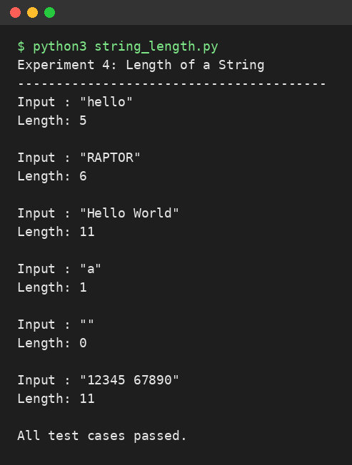

# Experiment 4 – Flowchart to Find the Length of a String

**Tool:** RAPTOR  |  **Course Outcome:** CO1

## Aim
To design a flowchart that finds the length of a given string.

## Algorithm
1. Start
2. Input the string `s`
3. Set `count <- 0` and `i <- 1`
4. Set `n <- Length_Of(s)` (loop bound)
5. While `i <= n`: `count <- count + 1`, `i <- i + 1`
6. Output `count`
7. End

## Flowchart


Symbols used (RAPTOR convention): oval = Start/End, parallelogram = Input/Output, rectangle = Assignment, diamond = Decision (loop condition).

## Code (reference implementation)
[`code/string_length.py`](code/string_length.py) – a Python version that follows the same steps as the flowchart so the result can be verified.

## Output
```
$ python3 code/string_length.py
```


Raw text: [`output/console_output.txt`](output/console_output.txt)

## RAPTOR screenshots
Place the RAPTOR window / run screenshots in [`screenshots/`](screenshots/).

## Result
The flowchart correctly computes the length of any input string (including the empty string, which gives 0).

## Folder structure
```
Exp04-String-Length-RAPTOR/
├── README.md
├── code/string_length.py
├── diagrams/exp04_flowchart.png  (+ .dot source)
├── output/console_output.png / .txt
└── screenshots/
```
