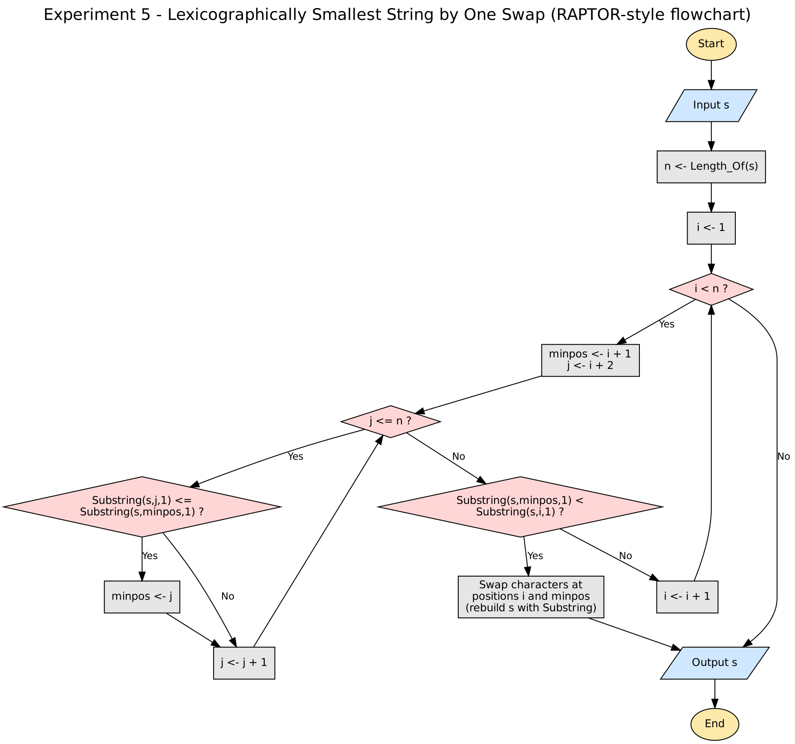
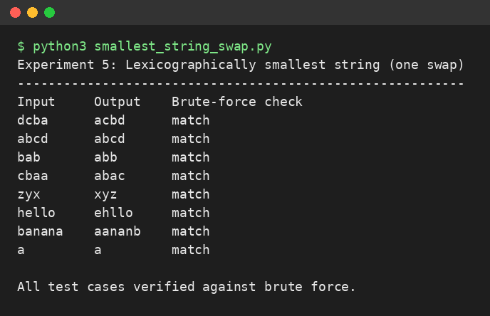

# Experiment 5 – Lexicographically Smallest String by Swapping Two Characters

**Tool:** RAPTOR  |  **Course Outcome:** CO1

## Aim
To design a flowchart that produces the lexicographically smallest string obtainable by swapping two characters of the given string (at most one swap).

## Approach (greedy)
Scan the string from left to right. For position `i`, find the smallest character to its right (using its **last** occurrence). If that character is smaller than `s[i]`, swap them and stop. If no position improves, the string is already the smallest.

## Algorithm
1. Start; Input `s`; `n <- Length_Of(s)`; `i <- 1`
2. While `i < n`:
   1. `minpos <- i+1`; `j <- i+2`
   2. While `j <= n`: if `s[j] <= s[minpos]` then `minpos <- j`; `j <- j+1`
   3. If `s[minpos] < s[i]`: swap positions `i` and `minpos`, go to step 3
   4. `i <- i+1`
3. Output `s`; End

## Flowchart


## Code (reference implementation)
[`code/smallest_string_swap.py`](code/smallest_string_swap.py) – includes a brute-force checker that tries every possible swap and confirms the greedy answer.

## Output
```
$ python3 code/smallest_string_swap.py
```


Raw text: [`output/console_output.txt`](output/console_output.txt)

| Input | Output |
|-------|--------|
| dcba | acbd |
| abcd | abcd |
| bab | abb |
| cbaa | abac |
| hello | ehllo |

## RAPTOR screenshots
Place the RAPTOR window / run screenshots in [`screenshots/`](screenshots/).

## Result
The flowchart yields the lexicographically smallest string reachable with one swap; all test cases match the brute-force result.
