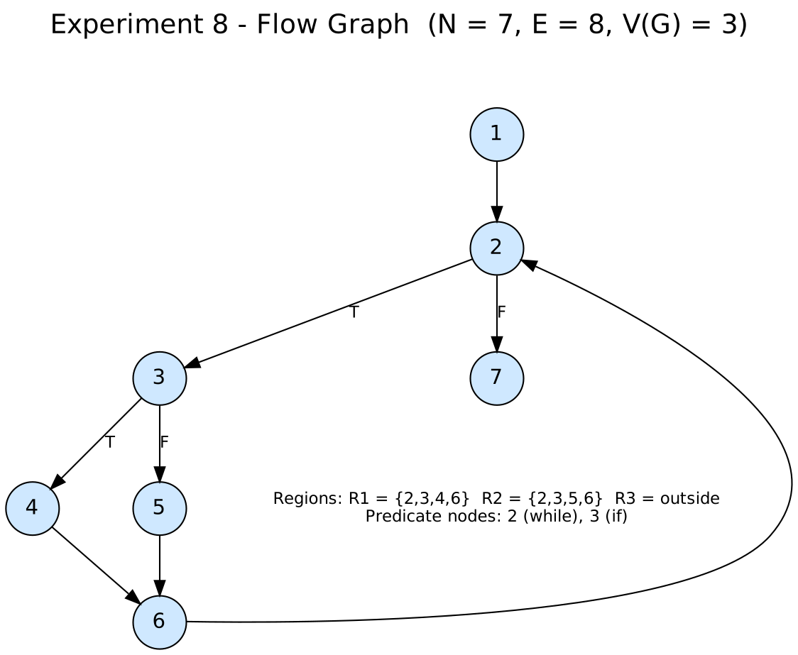
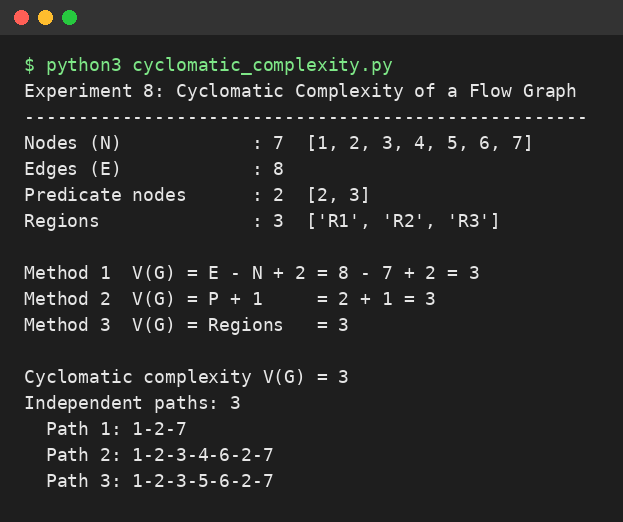

# Experiment 8 – Cyclomatic Complexity of a Flow Graph

**Tool:** RAPTOR  |  **Course Outcome:** CO1

## Aim
To draw the flow graph of a program and compute its cyclomatic complexity V(G).

## Program under analysis
[`code/sample_program.py`](code/sample_program.py) – computes an alternating sum with a `while` loop containing an `if / else`.

```
1: total = 0; i = 1
2: while i <= n
3:     if i % 2 == 0
4:         total += i
5:     else total -= i
6:     i += 1
7: return total
```

## Flow graph


## Calculation
| Method | Formula | Result |
|--------|---------|--------|
| Edges and nodes | V(G) = E − N + 2 = 8 − 7 + 2 | **3** |
| Predicate nodes | V(G) = P + 1 = 2 + 1 | **3** |
| Regions | R1, R2, R3 | **3** |

Independent paths: `1-2-7`, `1-2-3-4-6-2-7`, `1-2-3-5-6-2-7`.

Interpretation: V(G) = 3 means a low-risk, simple, easily testable module (3 test cases cover all independent paths).

## Code
[`code/cyclomatic_complexity.py`](code/cyclomatic_complexity.py) – computes V(G) by all three methods from the edge list and asserts that they agree.

## Output
```
$ python3 code/cyclomatic_complexity.py
```


Raw text: [`output/console_output.txt`](output/console_output.txt)

## RAPTOR screenshots
If your lab sheet requires the flowchart of the program in RAPTOR, build it there and place the screenshots in [`screenshots/`](screenshots/).

## Result
Cyclomatic complexity of the flow graph is **3**, verified by three methods.
