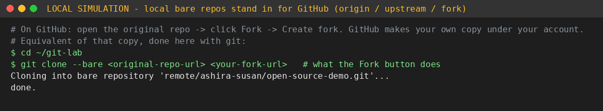
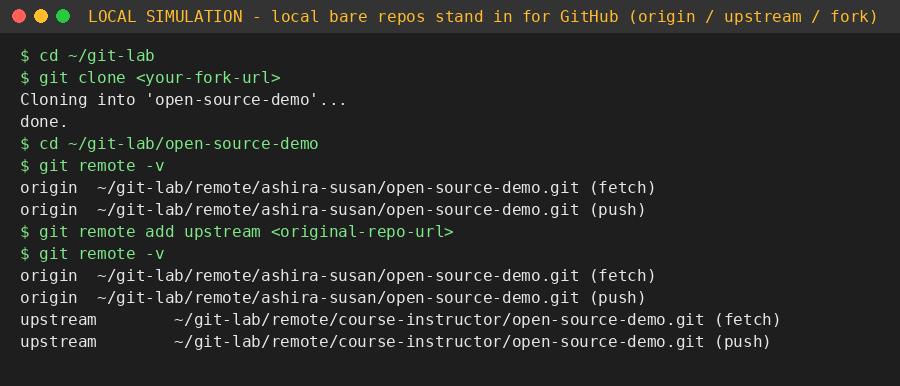
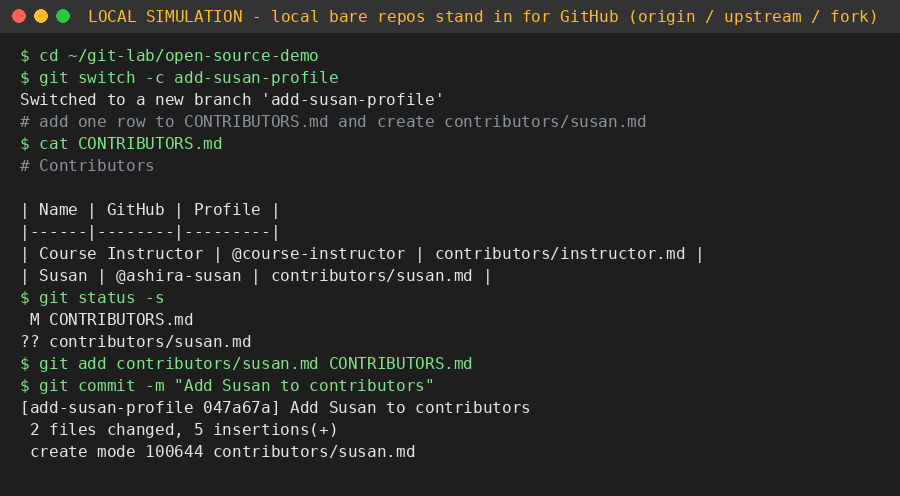
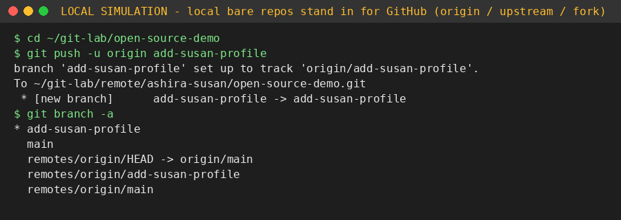
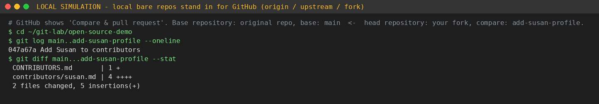
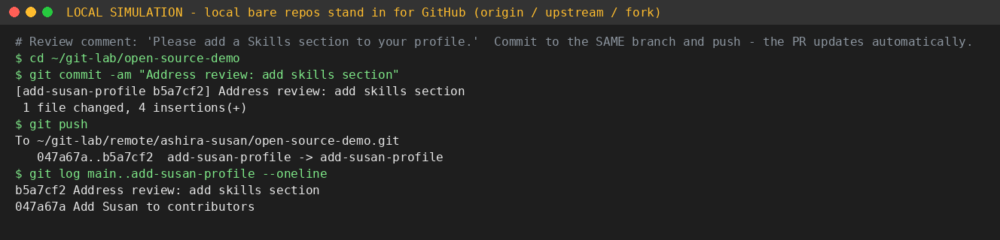
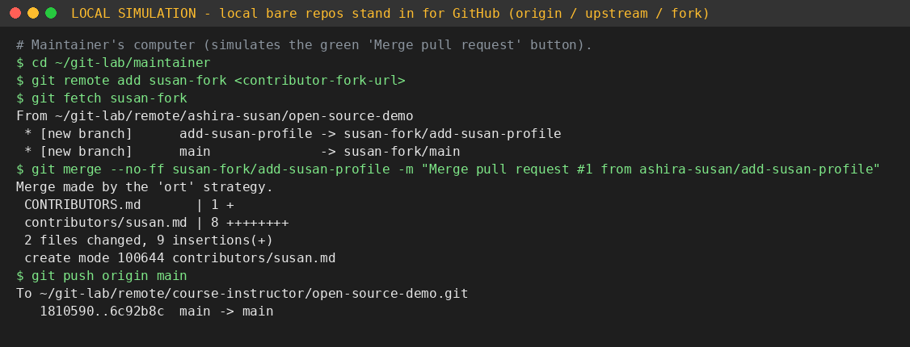
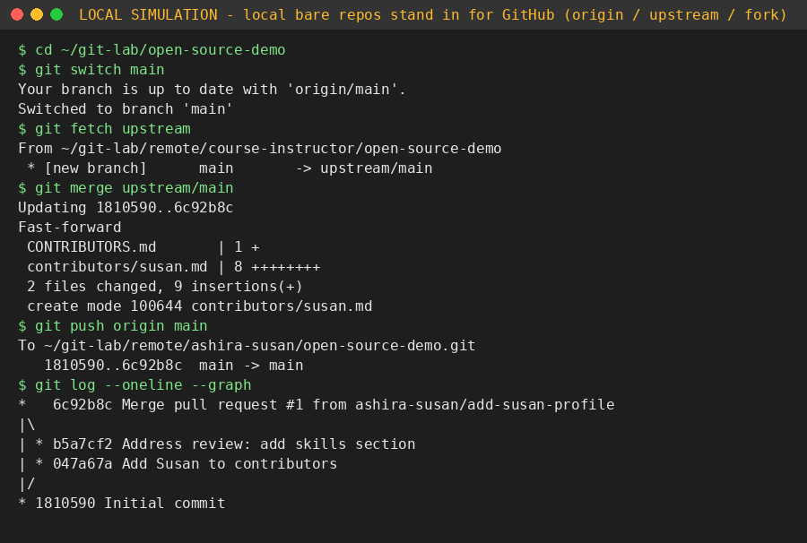
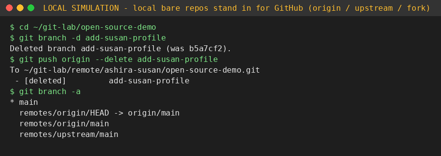

# Experiment 14 – Fork-and-Pull-Request Collaboration Workflow using Git and GitHub

**Tools:** Git, GitHub  |  **Course Outcome:** CO3

## Aim
To contribute to someone else's repository using the fork-and-pull-request workflow, including a review cycle.

## Key concepts
- Fork = your own server-side copy
- `origin` (your fork) and `upstream` (original) remotes
- Pull request from fork branch to the original repository
- Updating a PR with new commits; syncing your fork

## Prerequisites
- Git installed (`git --version`) and a GitHub account
- Git identity configured (the first step does this)
- Logged in for pushes: use a Personal Access Token or `gh auth login` – see `EXTRAS/GITHUB-SETUP-AND-AUTH.md`

You need a repository **owned by someone else** to fork (GitHub does not let you fork your own repository into the same account). Options: a classmate's repo, a second GitHub account of yours, or GitHub's public practice repository `octocat/Spoon-Knife`. The scripts ask for `UPSTREAM_OWNER` and `REPO`.

To make your own 'original' repository for a classmate to fork, create a repo and upload the files in `original-repo-files/`.

## Folder contents
```
Exp14-Fork-and-Pull-Request-Workflow/
├── README.md
├── commands/run_steps.sh        guided runner: runs each step and pauses for your screenshot
├── repo-files/                the files that end up in the repository (final state)
├── original-repo-files/       an 'original' repository you can publish for a classmate to fork
├── output/                      real Git sessions run in a local simulation (see below)
└── screenshots/                 put YOUR screenshots here (see CHECKLIST.md)
```

## Quick start
```bash
cd Exp14-Fork-and-Pull-Request-Workflow
bash commands/run_steps.sh
```
Steps marked 🌐 are done on github.com (browser).

## Steps and commands
`$GH_USER`, `$GIT_NAME`, `$GIT_EMAIL`, `$WORK` and `$EXP_DIR` are set by the script; type your own values if you run the commands by hand.

### Step 1 – Set your identity
```bash
git config --global user.name "$GIT_NAME" &&
  git config --global user.email "$GIT_EMAIL" &&
  git config --global --list
```

### Step 2 – 🌐 Fork the original repository
Open `https://github.com/<UPSTREAM_OWNER>/<REPO>` → click **Fork** → **Create fork**. Screenshot your fork page showing 'forked from <owner>/<repo>'.

### Step 3 – Clone your fork and add the upstream remote
```bash
cd "$WORK" &&
  git clone https://github.com/$GH_USER/$REPO.git &&
  cd "$REPO" &&
  git remote -v &&
  git remote add upstream https://github.com/$UPSTREAM_OWNER/$REPO.git &&
  git remote -v
```

### Step 4 – Create a contribution branch
```bash
git switch -c "add-$GH_USER-profile" && git branch
```

### Step 5 – Make your contribution and commit
```bash
mkdir -p contributors &&
  printf "# %s\n\n- GitHub: @%s\n" "$GIT_NAME" "$GH_USER" > "contributors/$GH_USER.md" &&
  echo "| $GIT_NAME | @$GH_USER | contributors/$GH_USER.md |" >> CONTRIBUTORS.md &&
  git status -s &&
  git add . &&
  git commit -m "Add $GH_USER to contributors" &&
  git log --oneline | head -5
```

### Step 6 – Push the branch to YOUR fork
```bash
git push -u origin "add-$GH_USER-profile"
```

> GitHub asks for credentials: username = your GitHub username, password = **Personal Access Token**.

### Step 7 – 🌐 Open the pull request
Click **Compare & pull request** on your fork. Check: base repository = the ORIGINAL repo, base = default branch; head repository = your fork. Use the text in `PULL_REQUEST.md`. Screenshot the PR (Conversation and Files changed).

### Step 8 – Address review comments (same branch)
```bash
printf "\n## Skills\n- Git and GitHub\n" >> "contributors/$GH_USER.md" &&
  git commit -am "Address review: add skills section" &&
  git push &&
  git log --oneline | head -5
```

### Step 9 – 🌐 Maintainer merges the PR
The original repository's owner (classmate / your second account) clicks **Merge pull request**. Screenshot the PR showing 'Merged' (or the open PR if nobody merges – ask your faculty whether that is accepted).

### Step 10 – Sync your fork with the original repository
```bash
git fetch upstream &&
  git remote set-head upstream -a >/dev/null &&
  BASE=$(git symbolic-ref --short refs/remotes/upstream/HEAD | cut -d/ -f2) &&
  git switch "$BASE" &&
  git fetch upstream &&
  git merge upstream/"$BASE" &&
  git push origin "$BASE" &&
  git log --oneline --graph | head -12
```

### Step 11 – Delete the finished branch
```bash
git branch -d "add-$GH_USER-profile" || git branch -D "add-$GH_USER-profile"; git push origin --delete "add-$GH_USER-profile"; git branch -a
```

## Output (local simulation)
The images below come from **real Git commands run in a local simulation**: bare local repositories stand in for GitHub (`origin`, `upstream`, your fork). They show exactly what Git prints for these commands, but they are **not screenshots of github.com** – take your own for the parts marked 🌐. Full text: [`output/session_local_simulation.txt`](output/session_local_simulation.txt).

**Fork the repository github fork button**


**Clone your fork and add the upstream rem**


**Create a branch and make your contributi**


**Push the branch to your fork**


**Open the pull request github**


**Reviewer asks for changes update the sam**


**Maintainer merges the pull request**


**Sync your fork with the original reposit**


**Clean up the branch**


## Pull request text
Ready-made title and description: [`PULL_REQUEST.md`](PULL_REQUEST.md).

## Screenshots to submit
See [`screenshots/CHECKLIST.md`](screenshots/CHECKLIST.md).

## Viva questions
1. **What is a fork?** A copy of a repository under your account that stays linked to the original.
2. **Fork vs clone?** Fork is a server-side copy on GitHub; clone is a local copy on your computer.
3. **Why add an `upstream` remote?** To fetch changes from the original repository and keep your fork up to date.
4. **How do you update an open pull request?** Push more commits to the same branch of your fork.
5. **Why not push directly to the original repository?** You usually have no write access; the PR lets maintainers review first.

## Troubleshooting
| Problem | Fix |
|---|---|
| `fatal: 'upstream' already exists` | `git remote -v` to check, or `git remote set-url upstream <url>`. |
| Fork is behind the original | Run step 10, or use **Sync fork** on GitHub. |
| PR targets your own fork | Change **base repository** to the original in the PR form. |

## Result
A fork of the original repository was cloned, a contribution was pushed to a branch on the fork, proposed through a pull request, updated after review and merged, and the fork was synchronised.
