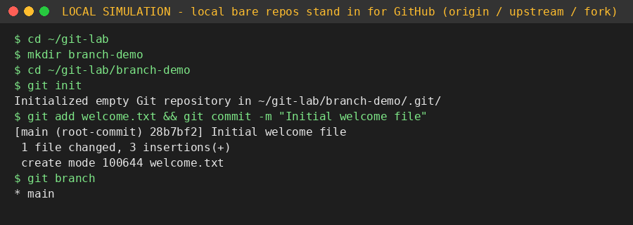
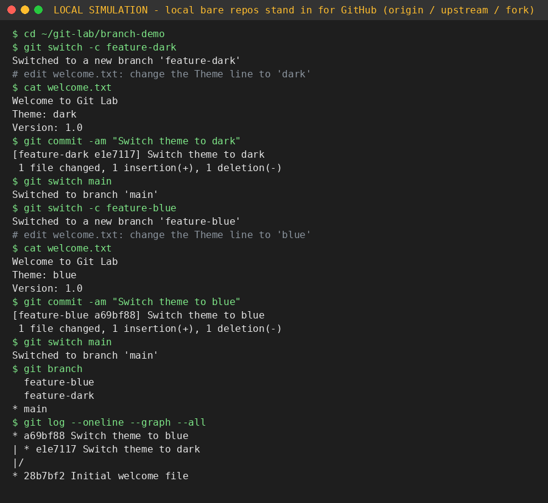
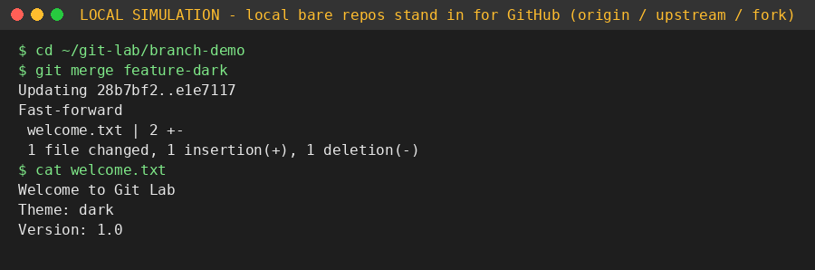
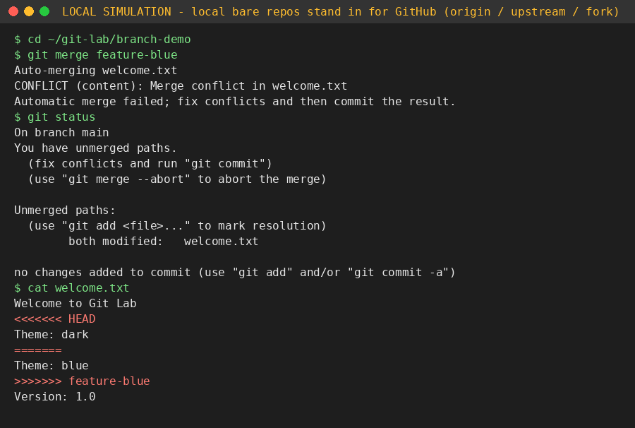
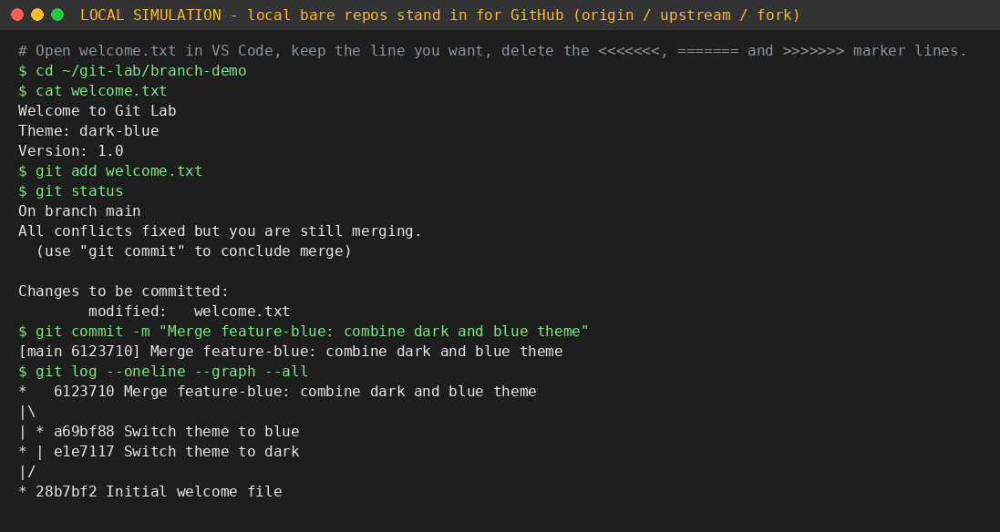
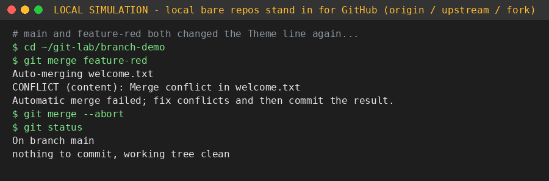
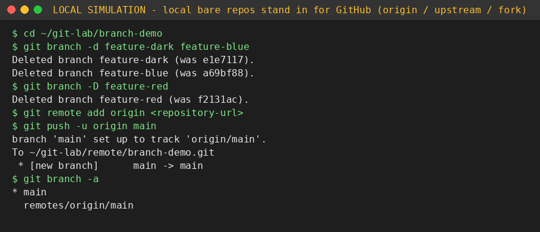

# Experiment 15 – Working with Git Branches and Resolving Merge Conflicts

**Tools:** Git, GitHub  |  **Course Outcome:** CO3

## Aim
To create and merge branches, deliberately cause a merge conflict, resolve it, and push the result to GitHub.

## Key concepts
- Branches: `git branch`, `git switch -c`
- Fast-forward merge vs merge with conflict
- Conflict markers `<<<<<<<`, `=======`, `>>>>>>>`
- `git merge --abort`

## Prerequisites
- Git installed (`git --version`) and a GitHub account
- Git identity configured (the first step does this)
- Logged in for pushes: use a Personal Access Token or `gh auth login` – see `EXTRAS/GITHUB-SETUP-AND-AUTH.md`

## Folder contents
```
Exp15-Git-Branches-Merge-Conflicts/
├── README.md
├── commands/run_steps.sh        guided runner: runs each step and pauses for your screenshot
├── repo-files/                the files that end up in the repository (final state)
├── output/                      real Git sessions run in a local simulation (see below)
└── screenshots/                 put YOUR screenshots here (see CHECKLIST.md)
```

## Quick start
```bash
cd Exp15-Git-Branches-Merge-Conflicts
bash commands/run_steps.sh
```
Steps marked 🌐 are done on github.com (browser).

## Steps and commands
`$GH_USER`, `$GIT_NAME`, `$GIT_EMAIL`, `$WORK` and `$EXP_DIR` are set by the script; type your own values if you run the commands by hand.

### Step 1 – Set your identity
```bash
git config --global user.name "$GIT_NAME" &&
  git config --global user.email "$GIT_EMAIL" &&
  git config --global --list
```

### Step 2 – Create the repository and first commit
```bash
mkdir -p "$WORK/branch-demo" &&
  cd "$WORK/branch-demo" &&
  git init -b main &&
  printf 'Welcome to Git Lab\nTheme: light\nVersion: 1.0\n' > welcome.txt &&
  git add welcome.txt &&
  git commit -m "Initial welcome file" &&
  git branch
```

### Step 3 – Two branches change the SAME line
```bash
git switch -c feature-dark &&
  sed -i 's/Theme: light/Theme: dark/' welcome.txt &&
  git commit -am "Switch theme to dark" &&
  git switch main &&
  git switch -c feature-blue &&
  sed -i 's/Theme: light/Theme: blue/' welcome.txt &&
  git commit -am "Switch theme to blue" &&
  git switch main &&
  git branch &&
  git log --oneline --graph --all
```

### Step 4 – Merge feature-dark (fast-forward)
```bash
git merge feature-dark && cat welcome.txt
```

### Step 5 – Merge feature-blue – CONFLICT
```bash
git merge feature-blue; git status; cat welcome.txt
```

### Step 6 – Resolve the conflict in VS Code
Open the folder in VS Code (`code .`) → open `welcome.txt`. Screenshot the conflict view (Accept Current / Accept Incoming / Accept Both). Then edit the Theme line to `Theme: dark-blue`, remove all marker lines and save. Screenshot the resolved file.
   *Fallback without an editor:* `printf 'Welcome to Git Lab\nTheme: dark-blue\nVersion: 1.0\n' > welcome.txt`

### Step 7 – Mark resolved and commit the merge
```bash
cat welcome.txt &&
  git add welcome.txt &&
  git status &&
  git commit -m "Merge feature-blue: combine dark and blue theme" &&
  git log --oneline --graph --all
```

### Step 8 – Second conflict – abort the merge
```bash
git switch -c feature-red &&
  sed -i 's/Theme: dark-blue/Theme: red/' welcome.txt &&
  git commit -qam "Switch theme to red" &&
  git switch -q main &&
  sed -i 's/Theme: dark-blue/Theme: green/' welcome.txt &&
  git commit -qam "Switch theme to green" &&
  git merge feature-red; git merge --abort; git status
```

### Step 9 – Delete merged branches
```bash
git branch -d feature-dark feature-blue && git branch -D feature-red && git branch
```

### Step 10 – 🌐 Create the empty repository on GitHub
github.com → **New repository** → `branch-demo`, Public, no README → **Create**.

### Step 11 – Push to GitHub
```bash
git remote add origin https://github.com/$GH_USER/branch-demo.git && git push -u origin main && git branch -a
```

> GitHub asks for credentials: username = your GitHub username, password = **Personal Access Token**.

### Step 12 – Push one extra branch
```bash
git switch -c feature-footer &&
  echo "Footer: Git Lab" >> welcome.txt &&
  git commit -am "Add footer line" &&
  git push -u origin feature-footer &&
  git switch main
```

### Step 13 – 🌐 Branches on GitHub
On the repository page open the branch dropdown (or **Branches**). Screenshot showing `main` and `feature-footer`; also screenshot the **commits** page showing the merge commit.

## Output (local simulation)
The images below come from **real Git commands run in a local simulation**: bare local repositories stand in for GitHub (`origin`, `upstream`, your fork). They show exactly what Git prints for these commands, but they are **not screenshots of github.com** – take your own for the parts marked 🌐. Full text: [`output/session_local_simulation.txt`](output/session_local_simulation.txt).

**Create the repository and first commit**


**Create two branches that change the same**


**Merge without conflict fast forward**


**Merge that causes a conflict**


**Resolve the conflict**


**Abort a merge you do not want**


**Clean up branches and push**


## Screenshots to submit
See [`screenshots/CHECKLIST.md`](screenshots/CHECKLIST.md).

## Viva questions
1. **What is a branch?** A lightweight movable pointer to a commit – an independent line of development.
2. **When does a merge conflict occur?** When both branches changed the same lines (or one deleted a file the other changed).
3. **What do the conflict markers mean?** `<<<<<<< HEAD` your current branch, `=======` separator, `>>>>>>> branch` the incoming branch.
4. **How do you cancel a conflicted merge?** `git merge --abort`.
5. **Fast-forward vs merge commit?** Fast-forward just moves the pointer; a merge commit joins two diverged histories.

## Troubleshooting
| Problem | Fix |
|---|---|
| `Your local changes would be overwritten by merge` | Commit or stash your work first. |
| Forgot to remove markers | Search for `<<<<<<<` before committing; Git does not check. |
| `error: failed to push` for new branch | Use `git push -u origin <branch>`. |

## Result
Branches were created and merged, a real merge conflict was produced and resolved, and the repository with its branches was pushed to GitHub.
