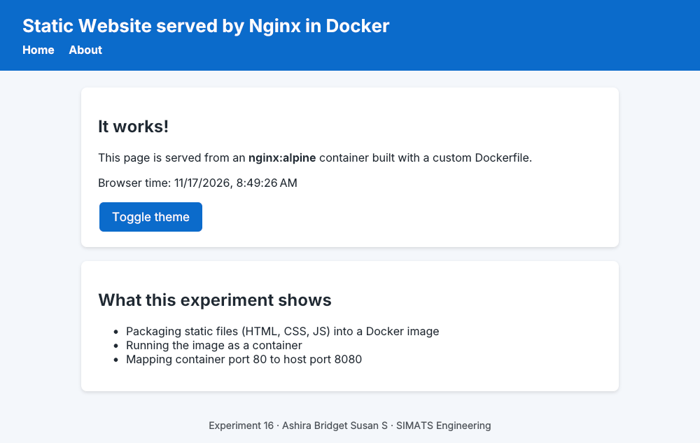
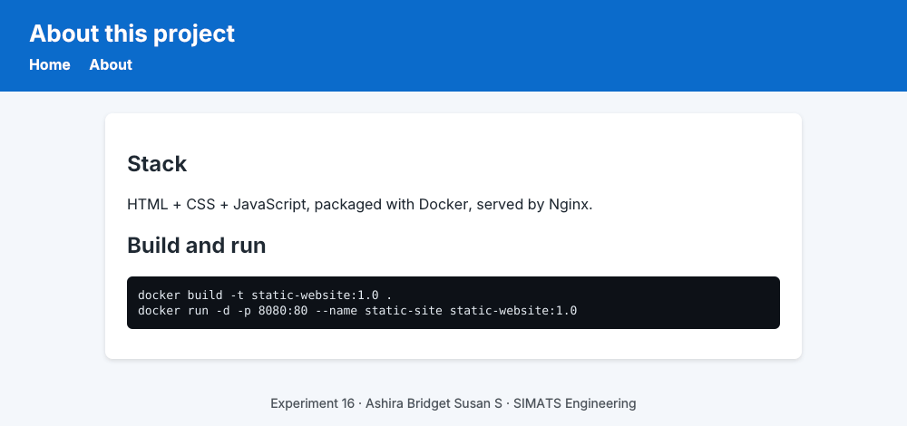

# Experiment 16 – Static Website Containerized and Served with Docker and Nginx

**Tool:** Docker  |  **Course Outcome:** CO3

## Aim
To package a static website (HTML, CSS, JavaScript) into a Docker image and serve it with an Nginx container.

## Prerequisites
Docker Desktop (or Docker Engine) installed – check with `docker --version`.

## Project structure
```
Exp16-Static-Website-Docker-Nginx/
├── website/            index.html, about.html, css/style.css, js/script.js
├── nginx.conf          custom Nginx server block (+ /healthz endpoint)
├── Dockerfile
├── docker-compose.yml  optional one-command run
├── .dockerignore
├── output/             preview renders of the pages
└── screenshots/        put YOUR terminal + browser screenshots here
```

## Dockerfile
```dockerfile
FROM nginx:alpine
COPY nginx.conf /etc/nginx/conf.d/default.conf
COPY website/ /usr/share/nginx/html/
EXPOSE 80
CMD ["nginx", "-g", "daemon off;"]
```

## Steps
```bash
# 1. go to the experiment folder
cd Exp16-Static-Website-Docker-Nginx

# 2. build the image
docker build -t static-website:1.0 .

# 3. confirm the image exists
docker images static-website

# 4. run the container (host 8080 -> container 80)
docker run -d -p 8080:80 --name static-site static-website:1.0

# 5. confirm it is running
docker ps

# 6. open the site
#    http://localhost:8080          (Home)
#    http://localhost:8080/about.html
curl http://localhost:8080/healthz      # prints: ok

# 7. view logs / stop / clean up
docker logs static-site
docker stop static-site
docker rm static-site
```
Alternative with Compose: `docker compose up -d --build` … `docker compose down`.

## Expected output (what you should see – replace with your own screenshots)
- `docker build` ends with `naming to docker.io/library/static-website:1.0`
- `docker ps` shows `static-site` with `0.0.0.0:8080->80/tcp` and status `Up`
- Browser at `http://localhost:8080` shows the page below




*(These two images are renders of the site's HTML files, so you can see what the page looks like. They are not screenshots of your container – take your own for submission.)*

## Screenshots to submit
See [`screenshots/CHECKLIST.md`](screenshots/CHECKLIST.md).

## Viva questions
1. **What is the role of Nginx here?** A lightweight web server that serves the static files from `/usr/share/nginx/html`.
2. **What does `-p 8080:80` mean?** Maps host port 8080 to container port 80.
3. **Why `nginx:alpine`?** Alpine-based image is small (~40 MB) and faster to pull.
4. **Difference between image and container?** An image is a read-only template; a container is a running instance of it.
5. **What does `.dockerignore` do?** Keeps unwanted files out of the build context.

## Troubleshooting
| Problem | Fix |
|---|---|
| `port is already allocated` | Use another host port: `-p 8081:80` |
| Page not loading | Check `docker ps` and `docker logs static-site` |
| Changes not visible | Rebuild: `docker build -t static-website:1.0 .` and recreate the container |

## Result
The static website was containerized with Docker and successfully served through Nginx on port 8080.
