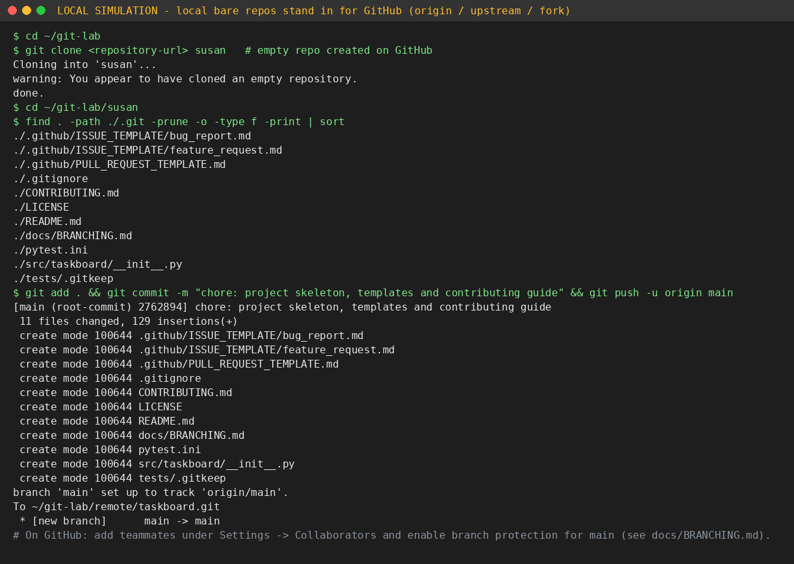
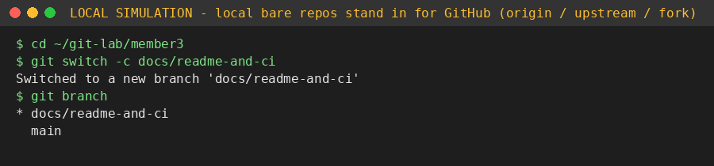
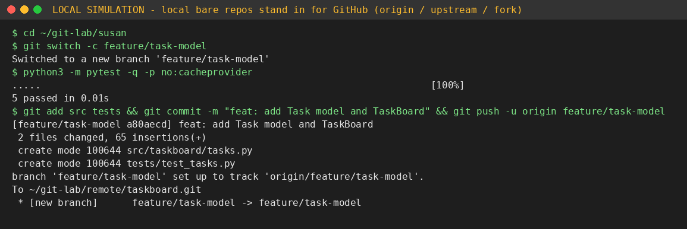
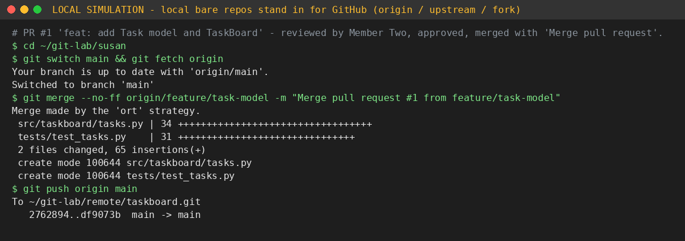
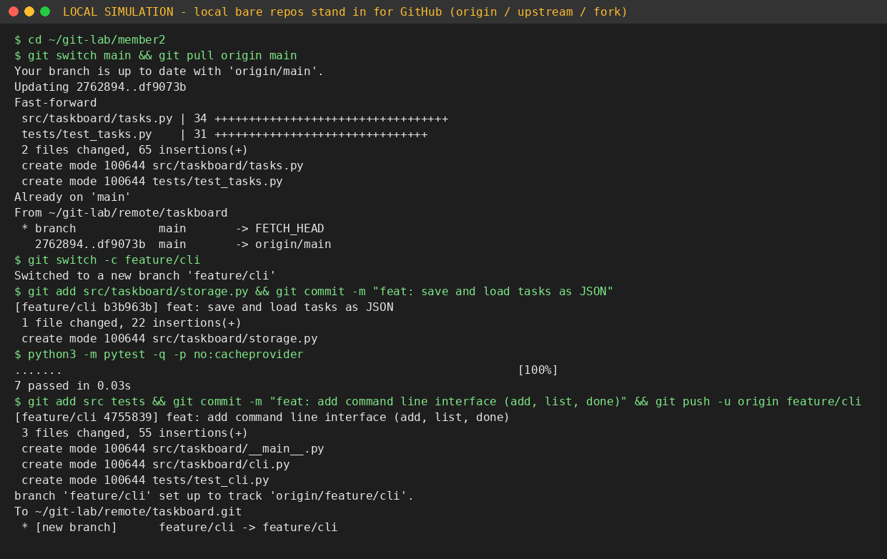
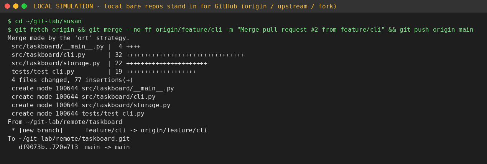
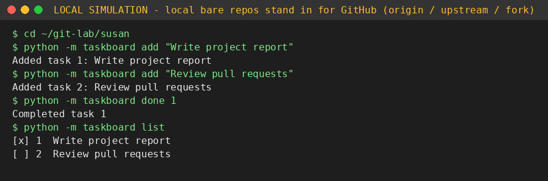
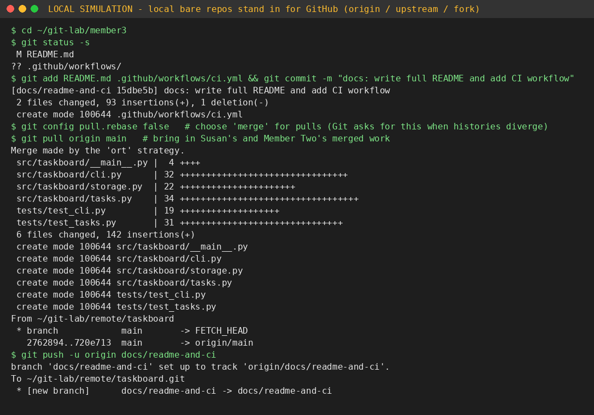
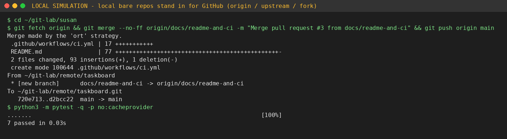
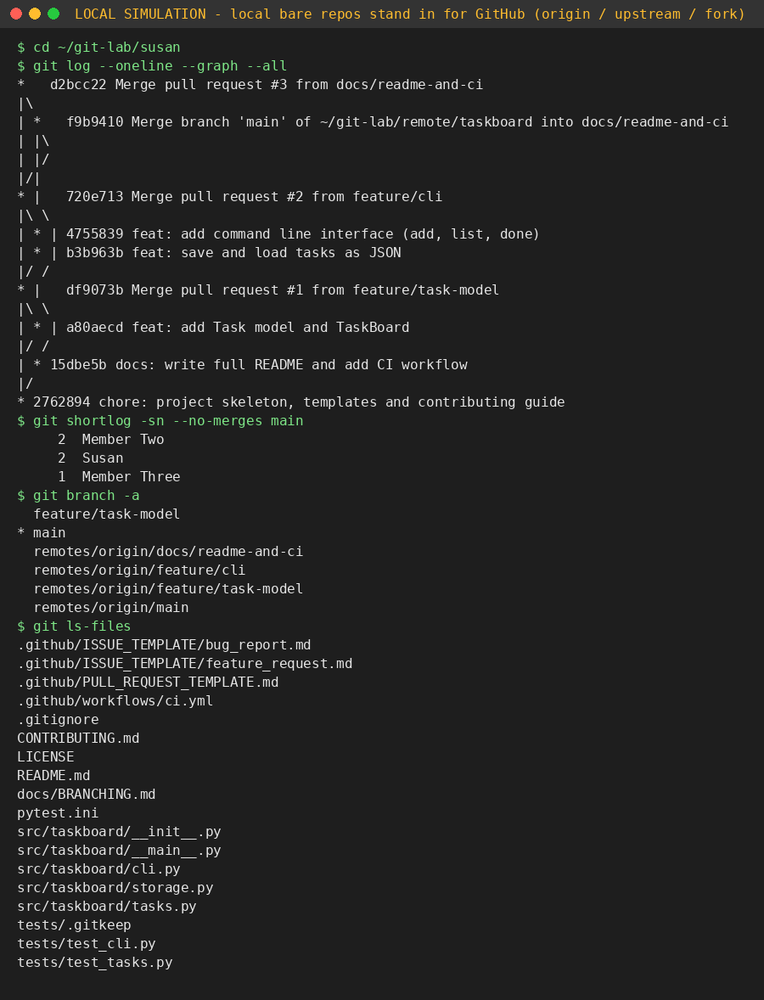

# Experiment 20 – Team Project Repository with Branches, Pull Requests and README Documentation

**Tools:** Git, GitHub  |  **Course Outcome:** CO5

## Aim
To set up a team project repository with a branching strategy, pull-request workflow, templates and complete README documentation.

## Key concepts
- GitHub Flow with protected `main`
- Feature / docs branches and pull requests with a template
- CONTRIBUTING.md, issue and PR templates, LICENSE, `.gitignore`
- README documentation and CI (GitHub Actions)

## Prerequisites
- Git installed (`git --version`) and a GitHub account
- Git identity configured (the first step does this)
- Logged in for pushes: use a Personal Access Token or `gh auth login` – see `EXTRAS/GITHUB-SETUP-AND-AUTH.md`

Best done with 2–3 teammates (add them under Settings → Collaborators). The script lets you do the whole flow alone: one person plays all three roles using separate branches.

## Folder contents
```
Exp20-Team-Project-Repository/
├── README.md
├── commands/run_steps.sh        guided runner: runs each step and pauses for your screenshot
├── repo-files/                the files that end up in the repository (final state)
├── output/                      real Git sessions run in a local simulation (see below)
└── screenshots/                 put YOUR screenshots here (see CHECKLIST.md)
```

## Quick start
```bash
cd Exp20-Team-Project-Repository
bash commands/run_steps.sh
```
Steps marked 🌐 are done on github.com (browser).

## Steps and commands
`$GH_USER`, `$GIT_NAME`, `$GIT_EMAIL`, `$WORK` and `$EXP_DIR` are set by the script; type your own values if you run the commands by hand.

### Step 1 – Set your identity
```bash
git config --global user.name "$GIT_NAME" &&
  git config --global user.email "$GIT_EMAIL" &&
  git config --global --list
```

### Step 2 – 🌐 Create the repository and invite the team
github.com → **New repository** → `taskboard-team` (Public, no README). Then **Settings → Collaborators → Add people** (your teammates). Screenshot the repository and the collaborators list.

### Step 3 – Clone and create the project skeleton
```bash
cd "$WORK" &&
  git clone https://github.com/$GH_USER/taskboard-team.git &&
  cd taskboard-team &&
  R="$EXP_DIR/repo-files" &&
  cp "$R/LICENSE" "$R/.gitignore" "$R/CONTRIBUTING.md" "$R/pytest.ini" . &&
  mkdir -p docs .github/ISSUE_TEMPLATE src/taskboard tests &&
  cp "$R/docs/BRANCHING.md" docs/ &&
  cp "$R/.github/PULL_REQUEST_TEMPLATE.md" .github/ &&
  cp "$R/.github/ISSUE_TEMPLATE/"*.md .github/ISSUE_TEMPLATE/ &&
  cp "$R/src/taskboard/__init__.py" src/taskboard/ &&
  touch tests/.gitkeep &&
  printf "# TaskBoard\n\n> README under construction.\n" > README.md &&
  git add . &&
  git commit -m "chore: project skeleton, templates and contributing guide" &&
  git branch -M main &&
  git log --oneline
```

### Step 4 – Push main
```bash
git push -u origin main
```

> GitHub asks for credentials: username = your GitHub username, password = **Personal Access Token**.

### Step 5 – 🌐 Protect the main branch
**Settings → Branches → Add branch ruleset / protection rule** for `main`: require a pull request before merging (1 approval). Screenshot the rule.

### Step 6 – Branch 1 – feature/task-model (team lead)
```bash
R="$EXP_DIR/repo-files" &&
  git switch -c feature/task-model &&
  cp "$R/src/taskboard/tasks.py" src/taskboard/ &&
  cp "$R/tests/test_tasks.py" tests/ &&
  python3 -m venv /tmp/venv-lab &&
  . /tmp/venv-lab/bin/activate &&
  pip install -q pytest &&
  python -m pytest -q &&
  git add src tests &&
  git commit -m "feat: add Task model and TaskBoard"
```

### Step 7 – Push the branch
```bash
git push -u origin feature/task-model
```

> GitHub asks for credentials: username = your GitHub username, password = **Personal Access Token**.

### Step 8 – 🌐 Pull request #1 (uses the PR template) and merge
**Compare & pull request** – the description is pre-filled from `.github/PULL_REQUEST_TEMPLATE.md`; tick the checklist. Ask a teammate to review/approve, then **Merge pull request**. Screenshot the PR with the template and the merged status.

### Step 9 – Branch 2 – feature/cli (teammate 2)
```bash
R="$EXP_DIR/repo-files" &&
  git switch main &&
  git pull origin main &&
  git switch -c feature/cli &&
  cp "$R/src/taskboard/storage.py" src/taskboard/ &&
  git add src &&
  git commit -m "feat: save and load tasks as JSON" &&
  cp "$R/src/taskboard/cli.py" "$R/src/taskboard/__main__.py" src/taskboard/ &&
  cp "$R/tests/test_cli.py" tests/ &&
  . /tmp/venv-lab/bin/activate &&
  python -m pytest -q &&
  git add src tests &&
  git commit -m "feat: add command line interface (add, list, done)" &&
  git log --oneline
```

### Step 10 – Push the branch
```bash
git push -u origin feature/cli
```

> GitHub asks for credentials: username = your GitHub username, password = **Personal Access Token**.

### Step 11 – 🌐 Pull request #2 and merge
Open the PR, request a review from a teammate, merge. Screenshot the PR (Files changed) and merged status.

### Step 12 – Branch 3 – docs/readme-and-ci (teammate 3)
```bash
R="$EXP_DIR/repo-files" &&
  git switch main &&
  git pull origin main &&
  git switch -c docs/readme-and-ci &&
  cp "$R/README.md" . &&
  sed -i "s#<owner>/<repo>#$GH_USER/taskboard-team#g; s#<repo>#taskboard-team#g; s#<username-1>#$GH_USER#g" README.md &&
  mkdir -p .github/workflows &&
  cp "$R/.github/workflows/ci.yml" .github/workflows/ &&
  git add . &&
  git commit -m "docs: write full README and add CI workflow" &&
  git push -u origin docs/readme-and-ci
```

### Step 13 – 🌐 Pull request #3 – CI check and merge
Open the PR; wait for the **CI** check (GitHub Actions) to turn green. Screenshot the PR showing the passing check, then merge it.

### Step 14 – Final checks on main
```bash
. /tmp/venv-lab/bin/activate; git switch main &&
  git pull origin main &&
  python -m pytest -q &&
  git log --oneline --graph --all &&
  git shortlog -sn --no-merges
```

### Step 15 – 🌐 Overview screenshots
Screenshot: (a) the repository home page with the rendered README, (b) **Pull requests → Closed** list showing the 3 merged PRs, (c) **Insights → Contributors** (or Network graph), (d) **Actions** tab with the green CI run.

## Output (local simulation)
The images below come from **real Git commands run in a local simulation**: bare local repositories stand in for GitHub (`origin`, `upstream`, your fork). They show exactly what Git prints for these commands, but they are **not screenshots of github.com** – take your own for the parts marked 🌐. Full text: [`output/session_local_simulation.txt`](output/session_local_simulation.txt).

**Susan creates the repository skeleton**


**Member three starts the documentation br**


**Susan feature task model**


**Pull request 1 reviewed and merged susan**


**Member two pulls main then builds featur**


**Pull request 2 reviewed and merged membe**


**Try the application output used in the r**


**Member three readme and ci on docs readm**


**Pull request 3 merged final checks on ma**


**Project history and team contribution**


## Screenshots to submit
See [`screenshots/CHECKLIST.md`](screenshots/CHECKLIST.md).

## Viva questions
1. **What is GitHub Flow?** Short-lived branches from `main`, pull requests with review, merge, delete branch.
2. **Why protect `main`?** Prevents direct pushes and forces review and passing checks.
3. **What belongs in a good README?** Overview, features, setup, usage, project structure, team, contribution guide, license.
4. **What is CODEOWNERS / PR template for?** Templates standardise PR descriptions; CODEOWNERS auto-requests reviewers.
5. **Why CI on pull requests?** Tests run automatically so broken code is caught before merge.

## Troubleshooting
| Problem | Fix |
|---|---|
| Cannot approve own PR | GitHub forbids it – ask a teammate, or temporarily relax the rule for the lab. |
| CI badge shows 'no status' | Replace `<owner>/<repo>` in README with your real names and push once to run the workflow. |
| Merge conflict on README | Pull `main` into your branch and resolve it as in Experiment 15. |

## Result
A team repository was created with a branching strategy, templates, three feature/docs branches merged through reviewed pull requests, CI, and complete README documentation.
