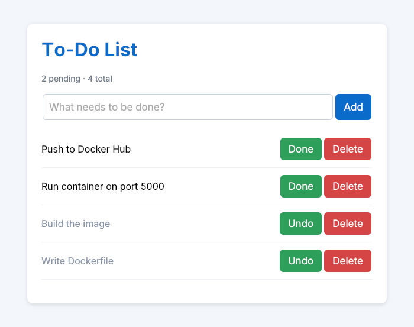

# Experiment 21 – Containerizing a Python Flask To-Do Application using Docker

**Tools:** Docker, Flask  |  **Course Outcome:** CO5

## Aim
To containerize a Python Flask To-Do application (SQLite database) using Docker, with a volume so tasks survive container restarts.

## Features
Add tasks, mark done/undo, delete, pending counter, JSON endpoint `/api/tasks`, health check `/health`.

## Project structure
```
Exp21-Flask-ToDo-Docker/
├── app/app.py                Flask + SQLite
├── app/templates/index.html  UI
├── tests/test_todo.py        4 unit tests
├── requirements.txt
├── Dockerfile
├── docker-compose.yml        named volume for /data
├── .dockerignore
├── output/                   real test output + preview render of the app page
└── screenshots/
```

## Dockerfile (key parts)
```dockerfile
FROM python:3.12-slim
ENV TODO_DB=/data/todo.db
WORKDIR /app
COPY requirements.txt .
RUN pip install --no-cache-dir -r requirements.txt
COPY app/ .
RUN mkdir -p /data
VOLUME ["/data"]
EXPOSE 5000
CMD ["gunicorn", "--bind", "0.0.0.0:5000", "--workers", "1", "app:app"]
```

## Steps
```bash
cd Exp21-Flask-ToDo-Docker

# (optional) run the tests first
pip install -r requirements.txt pytest && python -m pytest tests -v

# build and run
docker build -t flask-todo:1.0 .
docker run -d -p 5000:5000 -v todo_data:/data --name flask-todo flask-todo:1.0
docker ps

# use the app
#   http://localhost:5000       (add a few tasks)
curl http://localhost:5000/api/tasks
curl http://localhost:5000/health

# prove data persistence
docker stop flask-todo && docker rm flask-todo
docker run -d -p 5000:5000 -v todo_data:/data --name flask-todo flask-todo:1.0
#   refresh the page - the tasks are still there

# logs / cleanup
docker logs flask-todo
docker stop flask-todo && docker rm flask-todo
docker volume rm todo_data
```
Compose alternative: `docker compose up -d --build` … `docker compose down` (add `-v` to delete the volume).

## Real output
Tests: [`output/pytest_output.txt`](output/pytest_output.txt) (4 passed).

Page rendered from the app's own template with sample data (not a Docker screenshot – take your own):



## Screenshots to submit
See [`screenshots/CHECKLIST.md`](screenshots/CHECKLIST.md).

## Viva questions
1. **Why a volume?** Container filesystems are ephemeral; a volume keeps the SQLite file when the container is removed.
2. **Why copy `requirements.txt` before the code?** Layer caching – dependencies are reinstalled only when requirements change.
3. **`CMD` vs `ENTRYPOINT`?** `CMD` gives default arguments that can be overridden; `ENTRYPOINT` defines the fixed executable.
4. **Why gunicorn with 1 worker here?** SQLite is a single file; one worker avoids write contention in this lab app.
5. **`EXPOSE` vs `-p`?** `EXPOSE` documents the port; `-p` actually publishes it on the host.

## Troubleshooting
| Problem | Fix |
|---|---|
| Port 5000 busy (macOS AirPlay) | Use `-p 5001:5000` and open port 5001 |
| Tasks vanish after restart | Run with `-v todo_data:/data` |
| Code change not reflected | Rebuild the image |

## Result
The Flask To-Do application was successfully containerized and runs on port 5000 with persistent storage.
