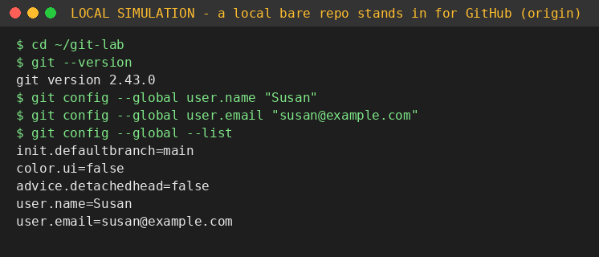
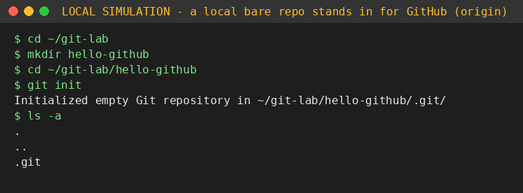
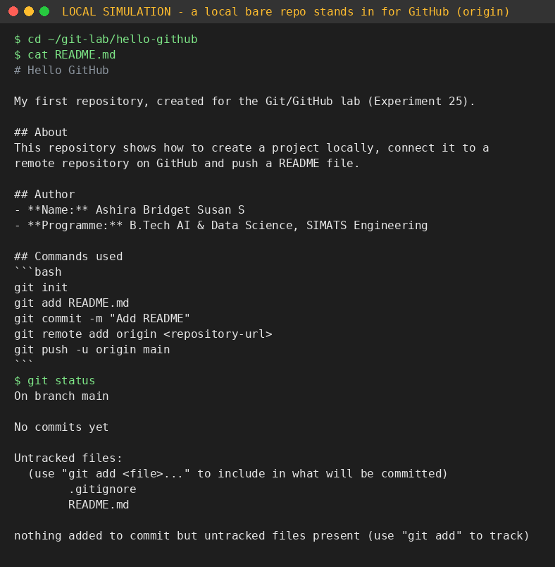
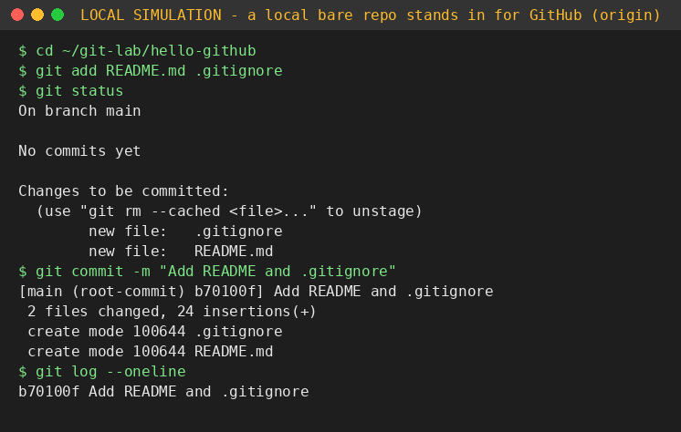
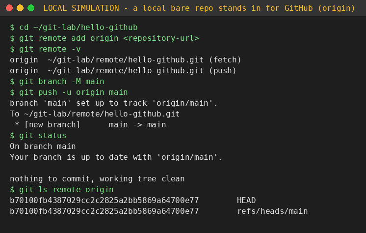

# Experiment 25 – Creating a GitHub Repository and Pushing a README File

**Tools:** Git, GitHub  |  **Course Outcome:** CO3

## Aim
To create a repository on GitHub, connect a local Git project to it and push a README file.

## Key concepts
- `git init`, `git add`, `git commit` – saving work locally
- `git remote add origin` – linking local and remote
- `git push -u origin main` – publishing the first commit

## Prerequisites
- Git installed (`git --version`) and a GitHub account
- Git identity configured (the first step does this)
- Logged in for pushes: use a Personal Access Token or `gh auth login` – see `EXTRAS/GITHUB-SETUP-AND-AUTH.md`

## Folder contents
```
Exp25-Create-GitHub-Repo-Push-README/
├── README.md
├── commands/run_steps.sh        guided runner: runs each step and pauses for your screenshot
├── repo-files/                the files that end up in the repository (final state)
├── output/                      real Git sessions run in a local simulation (see below)
└── screenshots/                 put YOUR screenshots here (see CHECKLIST.md)
```

## Quick start
```bash
cd Exp25-Create-GitHub-Repo-Push-README
bash commands/run_steps.sh
```
Steps marked 🌐 are done on github.com (browser).

## Steps and commands
`$GH_USER`, `$GIT_NAME`, `$GIT_EMAIL`, `$WORK` and `$EXP_DIR` are set by the script; type your own values if you run the commands by hand.

### Step 1 – Check Git and set your identity
```bash
git --version &&
  git config --global user.name "$GIT_NAME" &&
  git config --global user.email "$GIT_EMAIL" &&
  git config --global --list
```

### Step 2 – 🌐 Create the empty repository on GitHub
github.com → **+** → **New repository** → name `hello-github`, **Public**, do NOT tick 'Add a README' → **Create repository**. Screenshot the empty-repository page showing the quick-setup commands.

### Step 3 – Create the local project
```bash
mkdir -p "$WORK/hello-github" && cd "$WORK/hello-github" && git init -b main && ls -a
```

### Step 4 – Add README.md and .gitignore
```bash
cp "$EXP_DIR/repo-files/README.md" "$EXP_DIR/repo-files/.gitignore" . && cat README.md && git status
```

### Step 5 – Stage and commit
```bash
git add README.md .gitignore && git status && git commit -m "Add README and .gitignore" && git log --oneline
```

### Step 6 – Connect the remote
```bash
git remote add origin https://github.com/$GH_USER/hello-github.git && git remote -v && git branch -M main
```

### Step 7 – Push to GitHub
```bash
git push -u origin main
```

> GitHub asks for credentials: username = your GitHub username, password = **Personal Access Token**.

### Step 8 – 🌐 Check the repository page
Refresh your repository on github.com. Screenshot it showing README.md rendered and the commit message.

### Step 9 – Verify local and remote are in sync
```bash
git status && git log --oneline origin/main
```

## Output (local simulation)
The images below come from **real Git commands run in a local simulation**: bare local repositories stand in for GitHub (`origin`, `upstream`, your fork). They show exactly what Git prints for these commands, but they are **not screenshots of github.com** – take your own for the parts marked 🌐. Full text: [`output/session_local_simulation.txt`](output/session_local_simulation.txt).

**Check git and set identity**


**Create the local project**


**Create readme md and check status**


**Stage and commit**


**Connect the remote and push**


## Screenshots to submit
See [`screenshots/CHECKLIST.md`](screenshots/CHECKLIST.md).

## Viva questions
1. **What does `git init` do?** Creates a hidden `.git` folder that turns the directory into a Git repository.
2. **What is `origin`?** The default name for the remote repository URL.
3. **What does `-u` do in `git push -u origin main`?** Sets the upstream so later `git push` / `git pull` need no arguments.
4. **Why add a `.gitignore`?** To keep files you do not want tracked (logs, editor files) out of the repository.
5. **Difference between Git and GitHub?** Git is the version-control tool; GitHub is a hosting service for Git repositories.

## Troubleshooting
| Problem | Fix |
|---|---|
| `remote: Support for password authentication was removed` | Use a Personal Access Token as the password, or `gh auth login` (see EXTRAS/GITHUB-SETUP-AND-AUTH.md). |
| `error: remote origin already exists` | `git remote set-url origin <url>` |
| `src refspec main does not match any` | You have no commit yet, or your branch is named `master`: run `git branch -M main`. |

## Result
A local repository with a README was created and pushed to GitHub, where the README is displayed on the repository page.
