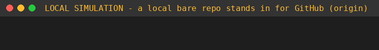
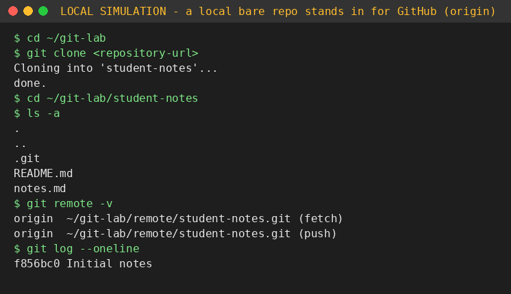
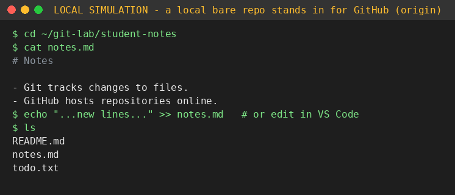
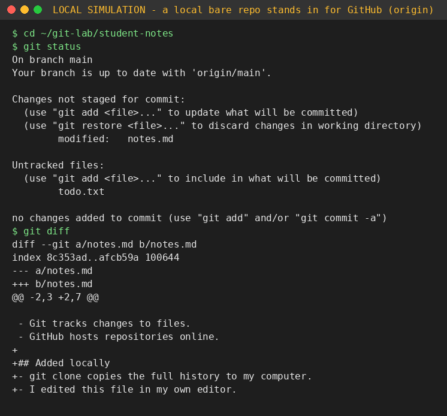
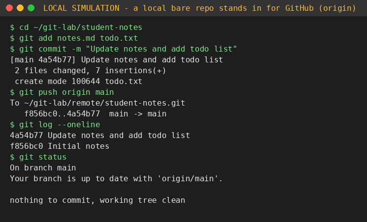

# Experiment 26 – Cloning a GitHub Repository and Editing Files Locally

**Tools:** Git, GitHub  |  **Course Outcome:** CO3

## Aim
To clone an existing GitHub repository to your computer, edit files locally and push the changes back.

## Key concepts
- `git clone` – full copy of a repository with its history
- `git status` / `git diff` – reviewing changes
- add → commit → push cycle

## Prerequisites
- Git installed (`git --version`) and a GitHub account
- Git identity configured (the first step does this)
- Logged in for pushes: use a Personal Access Token or `gh auth login` – see `EXTRAS/GITHUB-SETUP-AND-AUTH.md`

## Folder contents
```
Exp26-Clone-Repo-Edit-Locally/
├── README.md
├── commands/run_steps.sh        guided runner: runs each step and pauses for your screenshot
├── repo-files/                the files that end up in the repository (final state)
├── starter-files/             files to put in the GitHub repository BEFORE you start
├── output/                      real Git sessions run in a local simulation (see below)
└── screenshots/                 put YOUR screenshots here (see CHECKLIST.md)
```

## Quick start
```bash
cd Exp26-Clone-Repo-Edit-Locally
bash commands/run_steps.sh
```
Steps marked 🌐 are done on github.com (browser).

## Steps and commands
`$GH_USER`, `$GIT_NAME`, `$GIT_EMAIL`, `$WORK` and `$EXP_DIR` are set by the script; type your own values if you run the commands by hand.

### Step 1 – Set your identity
```bash
git config --global user.name "$GIT_NAME" &&
  git config --global user.email "$GIT_EMAIL" &&
  git config --global --list
```

### Step 2 – 🌐 Create the repository you will clone
github.com → **New repository** → `student-notes` (Public, no README) → **Create**. Click **uploading an existing file**, drag the two files from this folder's `starter-files/` (README.md, notes.md) → **Commit changes**. Screenshot the repository.

### Step 3 – Clone the repository
```bash
cd "$WORK" &&
  git clone https://github.com/$GH_USER/student-notes.git &&
  cd student-notes &&
  ls -a &&
  git remote -v &&
  git log --oneline
```

### Step 4 – Edit a file and create a new one
```bash
printf '\n## Added locally\n- git clone copies the full history to my computer.\n- I edited this file in my own editor.\n' >> notes.md &&
  printf '1. Learn git add / commit / push\n2. Try branches\n3. Open a pull request\n' > todo.txt &&
  ls &&
  cat notes.md
```

### Step 5 – Edit in VS Code (optional)
Run `code .` in the repository folder, change a line in `notes.md` by hand and save. Screenshot VS Code showing the modified file in the Source Control panel.

### Step 6 – Review the changes
```bash
git status && git diff
```

### Step 7 – Stage and commit
```bash
git add notes.md todo.txt && git commit -m "Update notes and add todo list" && git log --oneline
```

### Step 8 – Push to GitHub
```bash
git push origin main
```

> GitHub asks for credentials: username = your GitHub username, password = **Personal Access Token**.

### Step 9 – 🌐 See the changes on GitHub
Open the repository on github.com. Screenshot the updated file list and the latest commit message (and optionally the commit's diff).

## Output (local simulation)
The images below come from **real Git commands run in a local simulation**: bare local repositories stand in for GitHub (`origin`, `upstream`, your fork). They show exactly what Git prints for these commands, but they are **not screenshots of github.com** – take your own for the parts marked 🌐. Full text: [`output/session_local_simulation.txt`](output/session_local_simulation.txt).

**Setup a repository already exists on git**


**Clone the repository**


**Edit existing file and add a new file**


**Review the changes**


**Stage commit and push**


## Screenshots to submit
See [`screenshots/CHECKLIST.md`](screenshots/CHECKLIST.md).

## Viva questions
1. **`git clone` vs `git pull`?** Clone copies a whole repository the first time; pull updates an existing clone.
2. **What does `git diff` show?** Line-by-line differences between your working files and the last commit (or the staging area).
3. **What is the staging area?** A place where you choose which changes go into the next commit.
4. **Does clone copy history?** Yes, every commit and branch.
5. **HTTPS vs SSH clone URL?** HTTPS uses a token/password; SSH uses a key pair.

## Troubleshooting
| Problem | Fix |
|---|---|
| `fatal: repository not found` | Check the username/repository name and that you are logged in for private repos. |
| Push rejected | Run `git pull origin main` first (see Experiment 28). |
| Nothing to commit | Save the file in your editor first, then run `git status`. |

## Result
The repository was cloned, files were edited locally, and the changes were committed and pushed back to GitHub.
