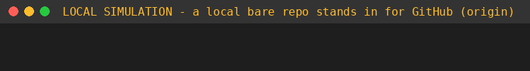
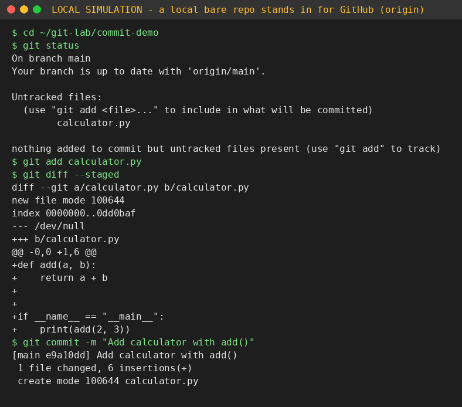
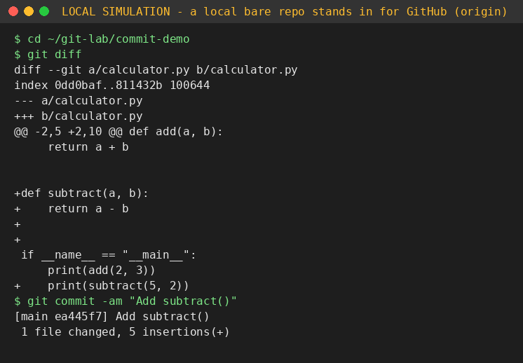
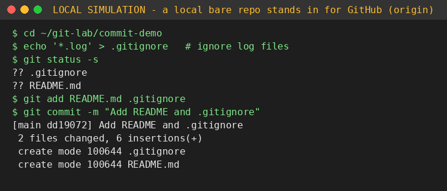
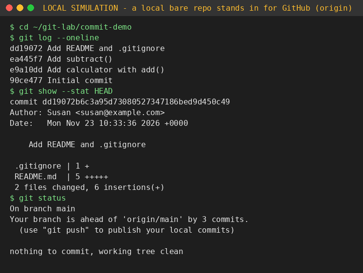
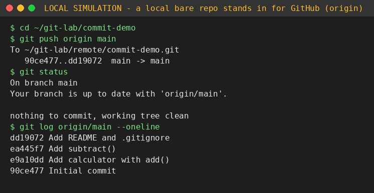

# Experiment 27 – Committing and Pushing Changes to GitHub

**Tools:** Git, GitHub  |  **Course Outcome:** CO4

## Aim
To make several commits locally, inspect the history, and push the changes to GitHub.

## Key concepts
- Working directory → staging area → repository
- Meaningful commit messages
- `.gitignore`, `git log`, `git show`
- `git push` publishes local commits

## Prerequisites
- Git installed (`git --version`) and a GitHub account
- Git identity configured (the first step does this)
- Logged in for pushes: use a Personal Access Token or `gh auth login` – see `EXTRAS/GITHUB-SETUP-AND-AUTH.md`

## Folder contents
```
Exp27-Commit-and-Push-Changes/
├── README.md
├── commands/run_steps.sh        guided runner: runs each step and pauses for your screenshot
├── repo-files/                the files that end up in the repository (final state)
├── output/                      real Git sessions run in a local simulation (see below)
└── screenshots/                 put YOUR screenshots here (see CHECKLIST.md)
```

## Quick start
```bash
cd Exp27-Commit-and-Push-Changes
bash commands/run_steps.sh
```
Steps marked 🌐 are done on github.com (browser).

## Steps and commands
`$GH_USER`, `$GIT_NAME`, `$GIT_EMAIL`, `$WORK` and `$EXP_DIR` are set by the script; type your own values if you run the commands by hand.

### Step 1 – Set your identity
```bash
git config --global user.name "$GIT_NAME" &&
  git config --global user.email "$GIT_EMAIL" &&
  git config --global --list
```

### Step 2 – 🌐 Create the repository
github.com → **New repository** → `commit-demo`, Public, **tick 'Add a README file'** → **Create**. Screenshot it.

### Step 3 – Clone it
```bash
cd "$WORK" && git clone https://github.com/$GH_USER/commit-demo.git && cd commit-demo && git log --oneline
```

### Step 4 – Commit 1 – add a file
```bash
cp "$EXP_DIR/repo-files/versions/calculator_v1.py" calculator.py &&
  git status &&
  git add calculator.py &&
  git diff --staged &&
  git commit -m "Add calculator with add()"
```

### Step 5 – Commit 2 – modify the file
```bash
cp "$EXP_DIR/repo-files/versions/calculator_v2.py" calculator.py &&
  git diff &&
  git commit -am "Add subtract()"
```

### Step 6 – Commit 3 – README and .gitignore
```bash
echo run.log > run.log &&
  echo '*.log' > .gitignore &&
  cp "$EXP_DIR/repo-files/README.md" README.md &&
  git status -s &&
  git add README.md .gitignore &&
  git commit -m "Add README and .gitignore"
```

### Step 7 – Review history before pushing
```bash
git log --oneline && git show --stat HEAD && git status
```

### Step 8 – Push all commits
```bash
git push origin main
```

> GitHub asks for credentials: username = your GitHub username, password = **Personal Access Token**.

### Step 9 – 🌐 Commit history on GitHub
On the repository page click the **N commits** link. Screenshot the commit list.

### Step 10 – Verify
```bash
git status && git log origin/main --oneline
```

## Output (local simulation)
The images below come from **real Git commands run in a local simulation**: bare local repositories stand in for GitHub (`origin`, `upstream`, your fork). They show exactly what Git prints for these commands, but they are **not screenshots of github.com** – take your own for the parts marked 🌐. Full text: [`output/session_local_simulation.txt`](output/session_local_simulation.txt).

**Setup clone the project**


**First change add a file**


**Second change modify the file**


**Ignore files and add documentation**


**Review history before pushing**


**Push to the remote**


## Screenshots to submit
See [`screenshots/CHECKLIST.md`](screenshots/CHECKLIST.md).

## Viva questions
1. **What is a commit?** A snapshot of the staged changes with an author, time and message.
2. **What makes a good commit message?** Short imperative summary of what changed and why, e.g. 'Add subtract()'.
3. **`git commit -am` – what is the catch?** It stages only already-tracked files; new files still need `git add`.
4. **Why is `*.log` in `.gitignore`?** Generated files should not be versioned.
5. **Can I undo the last commit?** Locally yes (`git reset`, `git commit --amend`); once pushed, prefer `git revert`.

## Troubleshooting
| Problem | Fix |
|---|---|
| `nothing added to commit` | You forgot `git add` (or saved nothing). |
| Push rejected (non-fast-forward) | Someone changed the remote: `git pull origin main`, then push. |
| Wrong commit message | `git commit --amend -m "new message"` – only before pushing. |

## Result
Three commits were created locally, the history was inspected, and all commits were pushed to GitHub.
