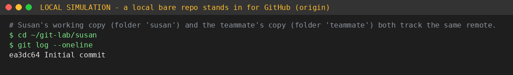
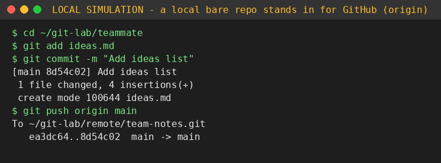
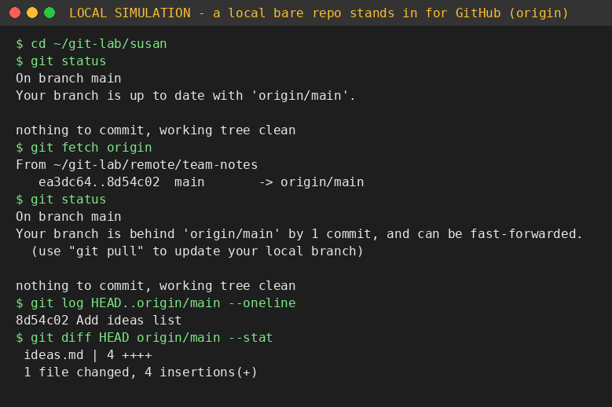
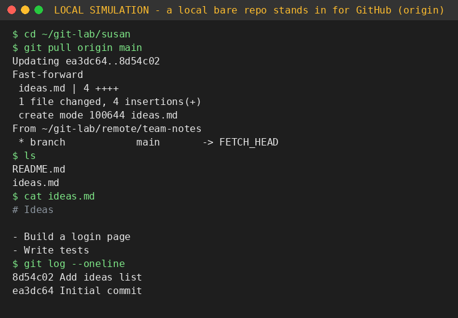
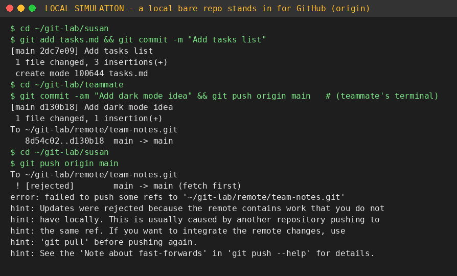
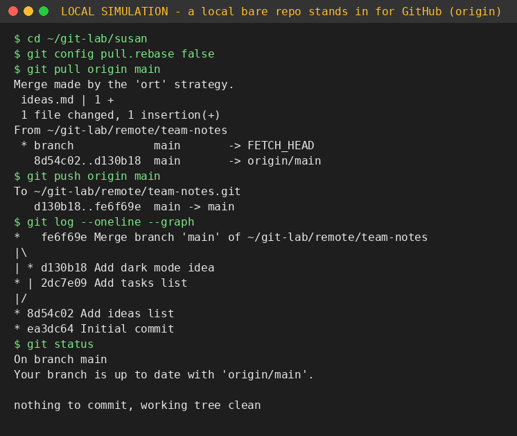

# Experiment 28 – Pulling Collaborator Changes from GitHub

**Tools:** Git, GitHub  |  **Course Outcome:** CO4

## Aim
To fetch and pull changes made by a collaborator, and to handle a rejected push when the remote has new work.

## Key concepts
- `git fetch` downloads without changing your files
- `git pull` = fetch + merge
- Rejected (non-fast-forward) push and how to fix it

## Prerequisites
- Git installed (`git --version`) and a GitHub account
- Git identity configured (the first step does this)
- Logged in for pushes: use a Personal Access Token or `gh auth login` – see `EXTRAS/GITHUB-SETUP-AND-AUTH.md`

## Folder contents
```
Exp28-Pull-Collaborator-Changes/
├── README.md
├── commands/run_steps.sh        guided runner: runs each step and pauses for your screenshot
├── repo-files/                the files that end up in the repository (final state)
├── output/                      real Git sessions run in a local simulation (see below)
└── screenshots/                 put YOUR screenshots here (see CHECKLIST.md)
```

## Quick start
```bash
cd Exp28-Pull-Collaborator-Changes
bash commands/run_steps.sh
```
Steps marked 🌐 are done on github.com (browser).

## Steps and commands
`$GH_USER`, `$GIT_NAME`, `$GIT_EMAIL`, `$WORK` and `$EXP_DIR` are set by the script; type your own values if you run the commands by hand.

### Step 1 – Set your identity
```bash
git config --global user.name "$GIT_NAME" &&
  git config --global user.email "$GIT_EMAIL" &&
  git config --global --list
```

### Step 2 – 🌐 Create the shared repository
github.com → **New repository** → `team-notes`, Public, **tick 'Add a README file'** → **Create**. (If you have a real teammate, add them under Settings → Collaborators.)

### Step 3 – Clone it
```bash
cd "$WORK" &&
  git clone https://github.com/$GH_USER/team-notes.git &&
  cd team-notes &&
  git config pull.rebase false &&
  git log --oneline
```

### Step 4 – 🌐 Your 'collaborator' pushes a change
Ask your teammate to push a commit – or play the teammate yourself: on github.com open the repo → **Add file → Create new file** → `ideas.md` with a few lines → **Commit changes** to `main`. Screenshot the new commit on GitHub.

### Step 5 – Fetch and inspect (nothing changes locally yet)
```bash
git status &&
  git fetch origin &&
  git status &&
  git log HEAD..origin/main --oneline &&
  git diff HEAD origin/main --stat
```

### Step 6 – Pull the collaborator's changes
```bash
git pull origin main && ls && cat ideas.md && git log --oneline
```

### Step 7 – Make your own local commit
```bash
printf '# Tasks\n\n- [ ] %s: design the UI\n' "$GIT_NAME" > tasks.md &&
  git add tasks.md &&
  git commit -m "Add tasks list"
```

### Step 8 – 🌐 Collaborator pushes again
On github.com open `ideas.md` → pencil icon → add a line → **Commit changes** to `main`. Screenshot the commit.

### Step 9 – Try to push – it is rejected
```bash
git push origin main; true
```

### Step 10 – Pull (merge) the new work
```bash
git pull --no-edit origin main && git log --oneline --graph
```

### Step 11 – Push again – now it works
```bash
git push origin main && git status
```

> GitHub asks for credentials: username = your GitHub username, password = **Personal Access Token**.

### Step 12 – 🌐 Commits page on GitHub
Open the repository's **commits** page. Screenshot the history showing the merge commit and both authors' commits.

## Output (local simulation)
The images below come from **real Git commands run in a local simulation**: bare local repositories stand in for GitHub (`origin`, `upstream`, your fork). They show exactly what Git prints for these commands, but they are **not screenshots of github.com** – take your own for the parts marked 🌐. Full text: [`output/session_local_simulation.txt`](output/session_local_simulation.txt).

**Setup two people share one repository**


**Teammate pushes a change**


**Susan checks for new work fetch**


**Susan pulls the changes**


**Both work push is rejected until you pul**


**Pull merge and push again**


## Screenshots to submit
See [`screenshots/CHECKLIST.md`](screenshots/CHECKLIST.md).

## Viva questions
1. **`git fetch` vs `git pull`?** Fetch only downloads remote changes; pull = fetch + merge into the current branch.
2. **Why was my push rejected?** The remote has commits you do not have; Git refuses to overwrite them.
3. **What is a fast-forward?** Moving the branch pointer ahead because there is no divergent work.
4. **What is `origin/main`?** Your local copy of the remote branch, updated by fetch/pull.
5. **Merge vs rebase when pulling?** Merge keeps a merge commit; rebase replays your commits on top for a linear history.

## Troubleshooting
| Problem | Fix |
|---|---|
| `You have divergent branches` | Choose a strategy once: `git config pull.rebase false` (merge) or `true` (rebase). |
| Editor opens during pull | Save and close it (accept the default merge message) or use `git pull --no-edit`. |
| Merge conflict during pull | See Experiment 15 for how to resolve it. |

## Result
Collaborator changes were fetched and pulled, a rejected push was resolved by pulling, and the merged work was pushed.
