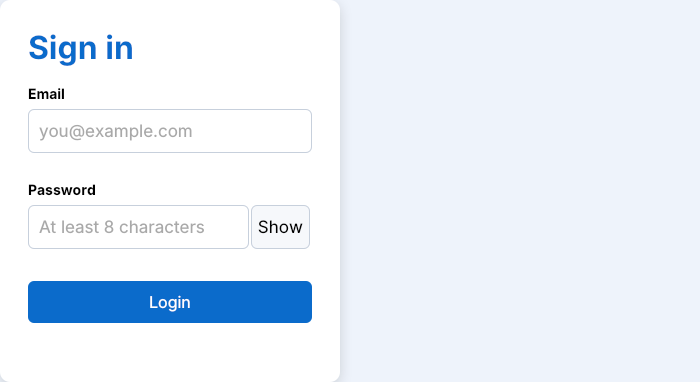
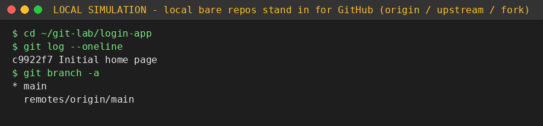
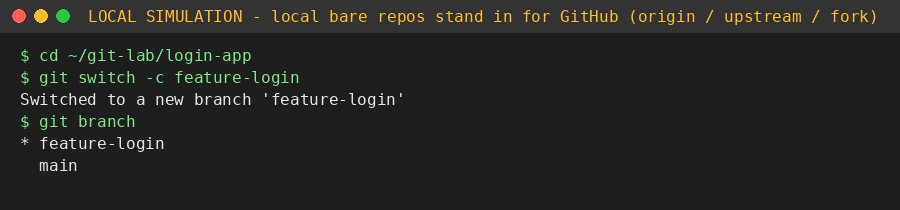
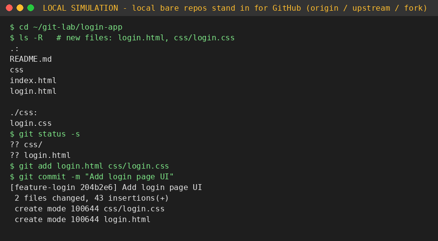
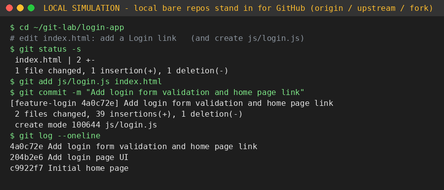
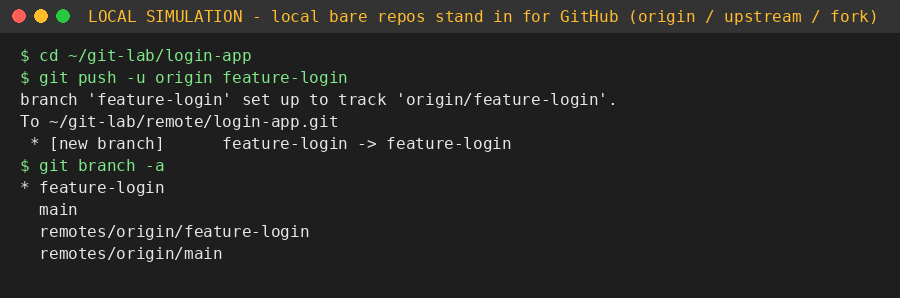
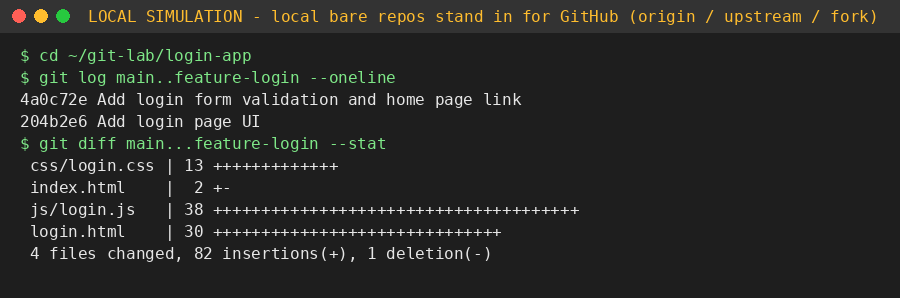
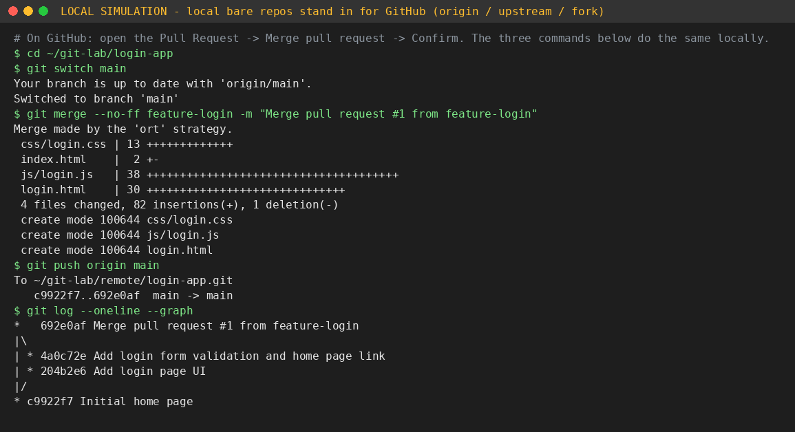
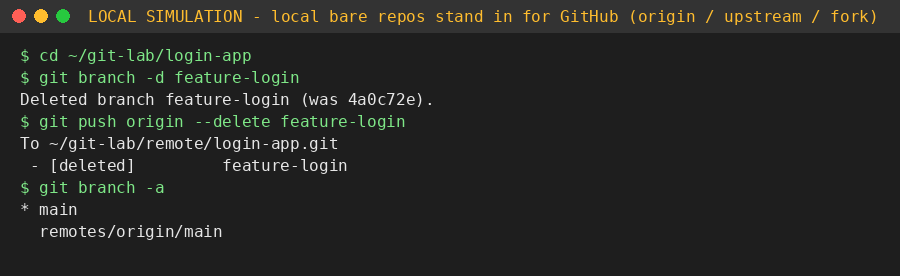

# Experiment 29 – Feature Branch (feature-login) and Pull Request

**Tools:** Git, GitHub  |  **Course Outcome:** CO4

## Aim
To develop a login feature on a separate `feature-login` branch and merge it into `main` using a pull request.

## Key concepts
- Feature-branch workflow
- Pushing a branch and opening a pull request
- Reviewing the diff, merging and deleting the branch

## Prerequisites
- Git installed (`git --version`) and a GitHub account
- Git identity configured (the first step does this)
- Logged in for pushes: use a Personal Access Token or `gh auth login` – see `EXTRAS/GITHUB-SETUP-AND-AUTH.md`

## Folder contents
```
Exp29-Feature-Branch-Login-PR/
├── README.md
├── commands/run_steps.sh        guided runner: runs each step and pauses for your screenshot
├── repo-files/                the files that end up in the repository (final state)
├── starter-files/             files to put in the GitHub repository BEFORE you start
├── output/                      real Git sessions run in a local simulation (see below)
└── screenshots/                 put YOUR screenshots here (see CHECKLIST.md)
```

## Quick start
```bash
cd Exp29-Feature-Branch-Login-PR
bash commands/run_steps.sh
```
Steps marked 🌐 are done on github.com (browser).

## Steps and commands
`$GH_USER`, `$GIT_NAME`, `$GIT_EMAIL`, `$WORK` and `$EXP_DIR` are set by the script; type your own values if you run the commands by hand.

### Step 1 – Set your identity
```bash
git config --global user.name "$GIT_NAME" &&
  git config --global user.email "$GIT_EMAIL" &&
  git config --global --list
```

### Step 2 – 🌐 Create the repository
github.com → **New repository** → `login-app` (Public, no README) → **uploading an existing file** → drag the files from `starter-files/` (README.md, index.html) → **Commit changes**. Screenshot the repository.

### Step 3 – Clone it
```bash
cd "$WORK" &&
  git clone https://github.com/$GH_USER/login-app.git &&
  cd login-app &&
  git log --oneline &&
  git branch -a
```

### Step 4 – Create the feature branch
```bash
git switch -c feature-login && git branch
```

### Step 5 – Commit 1 – login page UI
```bash
cp "$EXP_DIR/repo-files/login.html" . &&
  mkdir -p css &&
  cp "$EXP_DIR/repo-files/css/login.css" css/ &&
  git status -s &&
  git add login.html css/login.css &&
  git commit -m "Add login page UI"
```

### Step 6 – Commit 2 – validation and link
```bash
mkdir -p js &&
  cp "$EXP_DIR/repo-files/js/login.js" js/ &&
  cp "$EXP_DIR/repo-files/index.html" . &&
  git status -s &&
  git add js/login.js index.html &&
  git commit -m "Add login form validation and home page link" &&
  git log --oneline
```

### Step 7 – Try the page in a browser
Double-click `login.html` (or open it with Live Server). Screenshot the login page and also one with validation errors (wrong email / short password).

### Step 8 – Push the feature branch
```bash
git push -u origin feature-login
```

> GitHub asks for credentials: username = your GitHub username, password = **Personal Access Token**.

### Step 9 – 🌐 Open the pull request
On GitHub click **Compare & pull request**. Title: `Add login feature`. Paste the text from `PULL_REQUEST.md` into the description. Click **Create pull request**. Screenshot the PR page (Conversation tab) and the **Files changed** tab.

### Step 10 – 🌐 Review and merge
Add a review comment (you cannot approve your own PR – ask a classmate if you can). Click **Merge pull request → Confirm merge**. Screenshot the 'Merged' purple status.

### Step 11 – 🌐 Delete the branch
Click **Delete branch** on the merged PR. Screenshot.

### Step 12 – Update your local main
```bash
git switch main &&
  git pull origin main &&
  git log --oneline --graph &&
  git branch -d feature-login &&
  git fetch --prune &&
  git branch -a
```

## Output (local simulation)
The images below come from **real Git commands run in a local simulation**: bare local repositories stand in for GitHub (`origin`, `upstream`, your fork). They show exactly what Git prints for these commands, but they are **not screenshots of github.com** – take your own for the parts marked 🌐. Full text: [`output/session_local_simulation.txt`](output/session_local_simulation.txt).

**Login page preview**


**Setup project on main**


**Create the feature login branch**


**Develop the feature commit 1 login page **


**Commit 2 form validation and link from h**


**Push the feature branch**


**What the pull request will contain**


**Merge what github s merge pull request b**


**Delete the merged branch**


## Pull request text
Ready-made title and description: [`PULL_REQUEST.md`](PULL_REQUEST.md).

## Screenshots to submit
See [`screenshots/CHECKLIST.md`](screenshots/CHECKLIST.md).

## Viva questions
1. **Why use a feature branch?** Keeps unfinished work away from `main` and allows review before merging.
2. **What is a pull request?** A GitHub request to merge one branch into another, with discussion and review.
3. **What does 'Files changed' show?** The diff between the PR branch and the base branch.
4. **Merge commit vs squash vs rebase merge?** Merge keeps all commits plus a merge commit; squash combines them into one; rebase replays them linearly.
5. **Why delete the branch after merging?** Its work is in `main`; deleting avoids clutter.

## Troubleshooting
| Problem | Fix |
|---|---|
| 'Compare & pull request' button missing | Push the branch first; or use the **Pull requests → New pull request** page. |
| PR shows no changes | You may have compared the wrong branches – base must be `main`, compare `feature-login`. |
| Local branch won't delete with `-d` | If the PR was squashed, use `git branch -D feature-login`. |

## Result
The login feature was developed on `feature-login`, reviewed through a pull request and merged into `main`.
