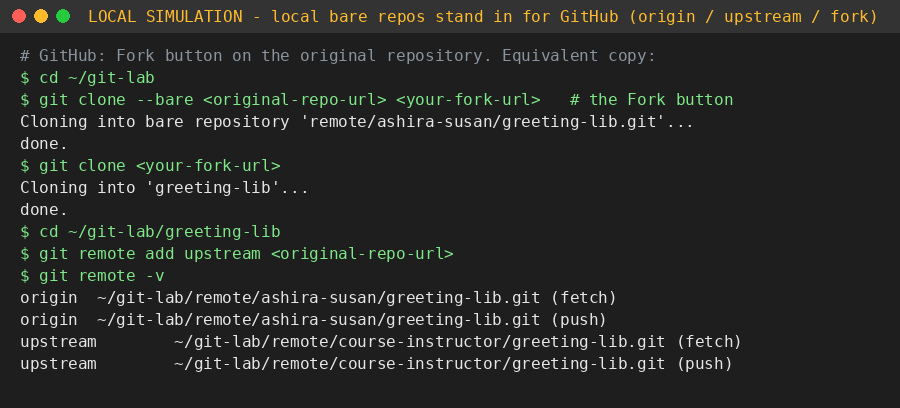
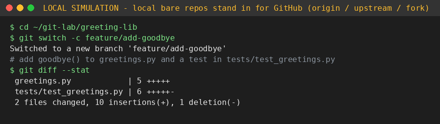
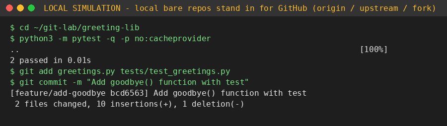
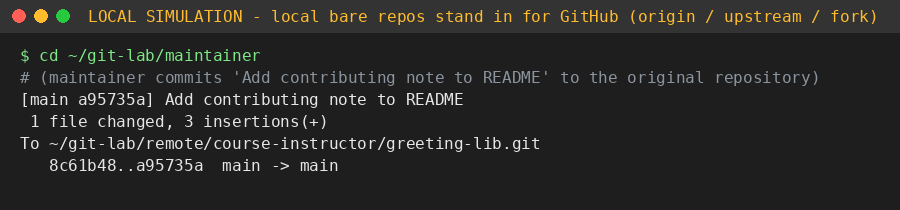
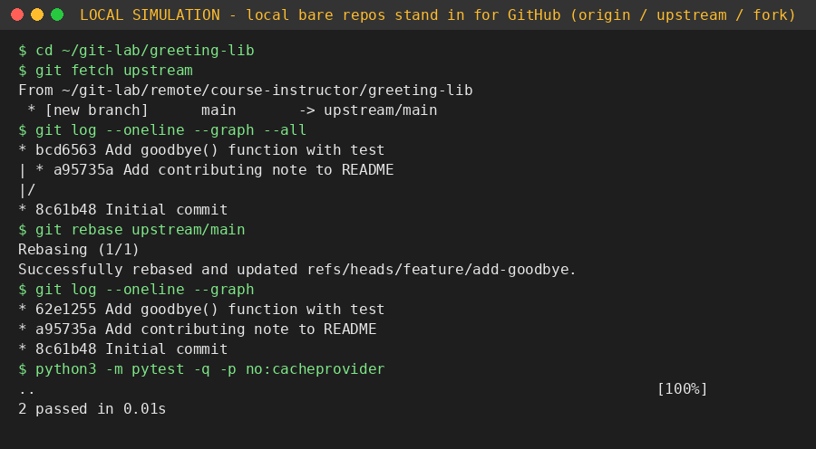
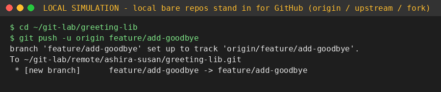
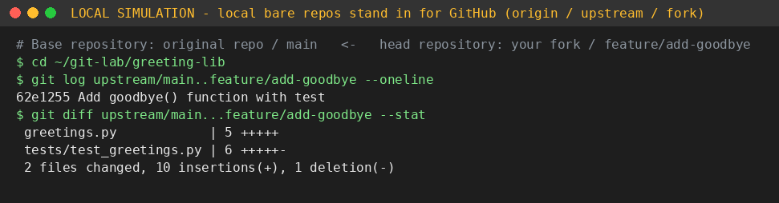
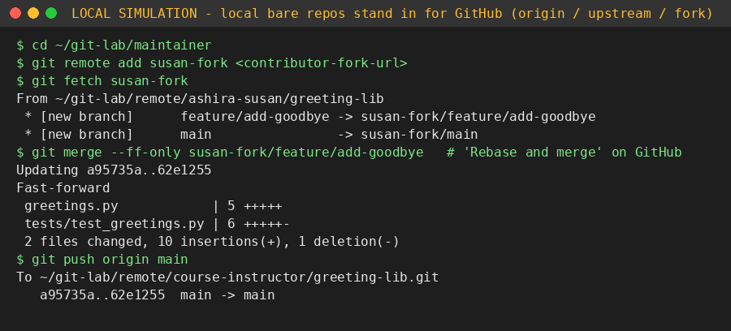
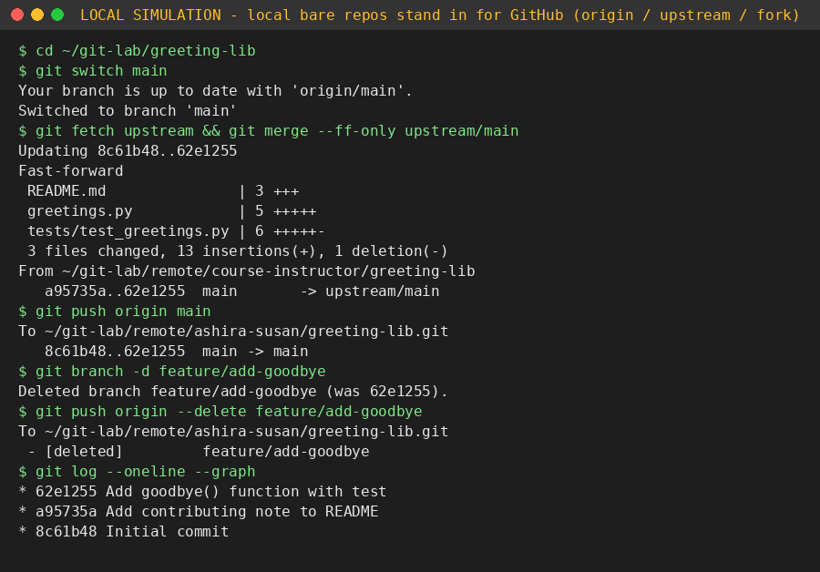

# Experiment 30 – Forking, Feature Branch and Pull Request to the Original Repository

**Tools:** Git, GitHub  |  **Course Outcome:** CO4

## Aim
To fork a repository, develop a feature on a feature branch, rebase it on the latest upstream work and open a pull request to the original repository.

## Key concepts
- Feature branch on a fork
- `git fetch upstream` + `git rebase upstream/main` to include newer upstream commits
- Pull request from fork to original
- Keeping the fork's `main` in sync

## Prerequisites
- Git installed (`git --version`) and a GitHub account
- Git identity configured (the first step does this)
- Logged in for pushes: use a Personal Access Token or `gh auth login` – see `EXTRAS/GITHUB-SETUP-AND-AUTH.md`

You need a repository **owned by someone else** to fork (GitHub does not let you fork your own repository into the same account). Options: a classmate's repo, a second GitHub account of yours, or GitHub's public practice repository `octocat/Spoon-Knife`. The scripts ask for `UPSTREAM_OWNER` and `REPO`.

`original-repo-files/` contains a small Python library (`greeting-lib`) you can publish from a second account so a classmate can fork it. The transcript in `output/` shows the full code-feature workflow with real tests; the script below uses a generic feature (a greeting file) that works with any repository.

## Folder contents
```
Exp30-Fork-Feature-Branch-PR-Upstream/
├── README.md
├── commands/run_steps.sh        guided runner: runs each step and pauses for your screenshot
├── repo-files/                the files that end up in the repository (final state)
├── original-repo-files/       an 'original' repository you can publish for a classmate to fork
├── output/                      real Git sessions run in a local simulation (see below)
└── screenshots/                 put YOUR screenshots here (see CHECKLIST.md)
```

## Quick start
```bash
cd Exp30-Fork-Feature-Branch-PR-Upstream
bash commands/run_steps.sh
```
Steps marked 🌐 are done on github.com (browser).

## Steps and commands
`$GH_USER`, `$GIT_NAME`, `$GIT_EMAIL`, `$WORK` and `$EXP_DIR` are set by the script; type your own values if you run the commands by hand.

### Step 1 – Set your identity
```bash
git config --global user.name "$GIT_NAME" &&
  git config --global user.email "$GIT_EMAIL" &&
  git config --global --list
```

### Step 2 – 🌐 Fork the original repository
Open `https://github.com/<UPSTREAM_OWNER>/<REPO>` → **Fork** → **Create fork**. Screenshot your fork page.

### Step 3 – Clone your fork and add upstream
```bash
cd "$WORK" &&
  git clone https://github.com/$GH_USER/$REPO.git &&
  cd "$REPO" &&
  git remote add upstream https://github.com/$UPSTREAM_OWNER/$REPO.git &&
  git remote -v
```

### Step 4 – Create the feature branch
```bash
git switch -c "feature/add-greeting-$GH_USER" && git branch
```

### Step 5 – Implement the feature and commit
```bash
mkdir -p greetings &&
  printf "Hello from %s!\n" "$GH_USER" > "greetings/$GH_USER.txt" &&
  echo "- Greeting added by @$GH_USER" >> README.md &&
  git status -s &&
  git add . &&
  git commit -m "Add greeting from $GH_USER" &&
  git log --oneline | head -5
```

### Step 6 – See what changed upstream meanwhile
```bash
git fetch upstream && git log --oneline --graph --all | head -15
```

### Step 7 – Rebase your branch on the latest upstream
```bash
git fetch upstream &&
  git remote set-head upstream -a >/dev/null &&
  BASE=$(git symbolic-ref --short refs/remotes/upstream/HEAD | cut -d/ -f2) &&
  git rebase upstream/"$BASE" &&
  git log --oneline --graph | head -10
```

### Step 8 – Push the feature branch to your fork
```bash
git push -u origin "feature/add-greeting-$GH_USER"
```

> GitHub asks for credentials: username = your GitHub username, password = **Personal Access Token**.

### Step 9 – 🌐 Open the pull request to the original repository
Click **Compare & pull request**. Base repository = ORIGINAL repo; head = your fork `feature/add-greeting-<you>`. Use the text in `PULL_REQUEST.md`. Screenshot the PR (Conversation + Files changed).

### Step 10 – 🌐 Maintainer reviews and merges
The original owner merges (or comments). Screenshot the PR status.

### Step 11 – Sync your fork's main
```bash
git fetch upstream &&
  git remote set-head upstream -a >/dev/null &&
  BASE=$(git symbolic-ref --short refs/remotes/upstream/HEAD | cut -d/ -f2) &&
  git switch "$BASE" &&
  git fetch upstream &&
  git merge --ff-only upstream/"$BASE" &&
  git push origin "$BASE" &&
  git log --oneline --graph | head -10
```

### Step 12 – Delete the feature branch
```bash
git branch -d "feature/add-greeting-$GH_USER" || git branch -D "feature/add-greeting-$GH_USER"; git push origin --delete "feature/add-greeting-$GH_USER"; git branch -a
```

## Output (local simulation)
The images below come from **real Git commands run in a local simulation**: bare local repositories stand in for GitHub (`origin`, `upstream`, your fork). They show exactly what Git prints for these commands, but they are **not screenshots of github.com** – take your own for the parts marked 🌐. Full text: [`output/session_local_simulation.txt`](output/session_local_simulation.txt).

**Fork and clone**


**Create a feature branch**


**Test then commit**


**The original repository moves ahead mean**


**Sync with upstream before opening the pr**


**Push the feature branch to your fork**


**Open the pull request github**


**Maintainer merges the pull request**


**Update your fork s main and delete the b**


## Pull request text
Ready-made title and description: [`PULL_REQUEST.md`](PULL_REQUEST.md).

## Screenshots to submit
See [`screenshots/CHECKLIST.md`](screenshots/CHECKLIST.md).

## Viva questions
1. **Why use a feature branch on a fork?** So your fork's `main` stays clean and identical to upstream, and the PR contains only your feature.
2. **Why rebase onto upstream before the PR?** It places your commits on top of the newest upstream work, avoiding conflicts and giving a linear history.
3. **When must you force-push?** After rebasing a branch that is already pushed (use `--force-with-lease`).
4. **Why `--ff-only` when syncing?** It fails loudly if your `main` diverged instead of creating a surprise merge commit.
5. **What is the difference between `origin` and `upstream`?** `origin` = your fork, `upstream` = the original repository.

## Troubleshooting
| Problem | Fix |
|---|---|
| Rebase conflict | Fix the files, `git add`, then `git rebase --continue` (or `git rebase --abort`). |
| `git push` rejected after rebase | `git push --force-with-lease origin <branch>` (only on your own feature branch). |
| `upstream/HEAD` not set | The script runs `git remote set-head upstream -a` for you. |

## Result
A feature was developed on a branch of a fork, rebased onto the latest upstream, proposed to the original repository through a pull request, and the fork was synchronised.
